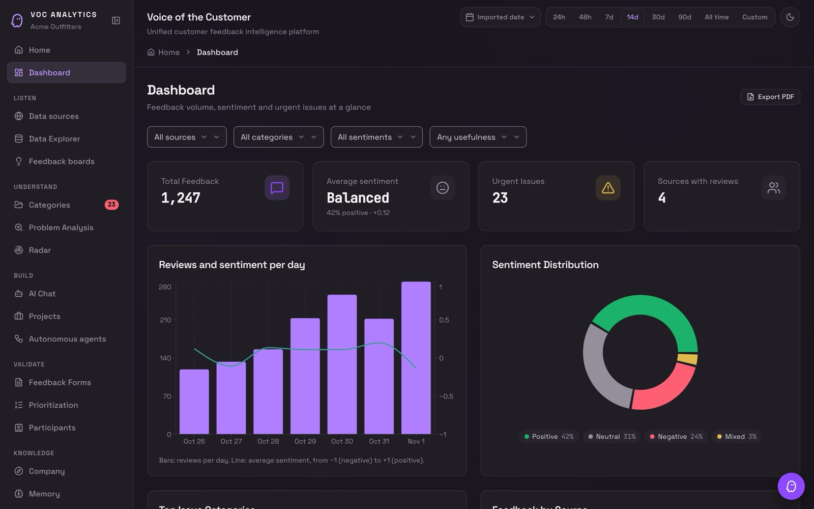
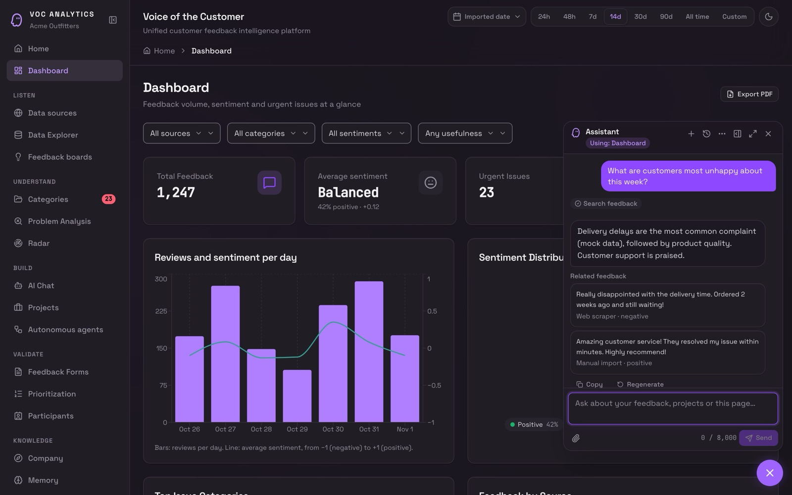
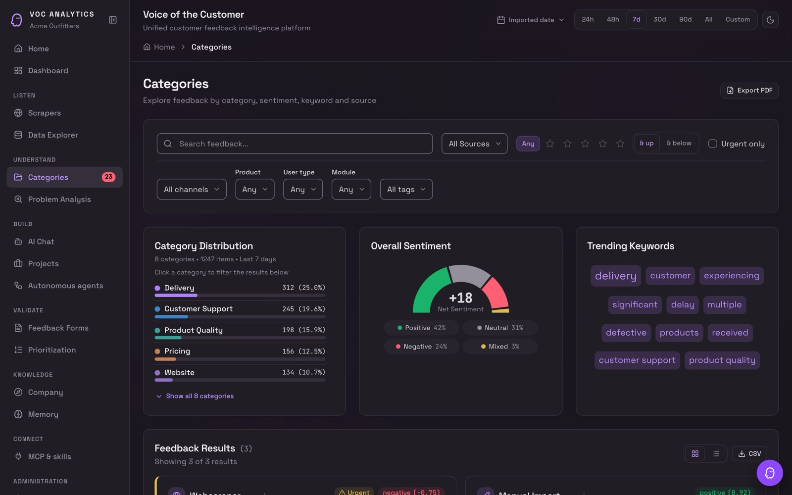
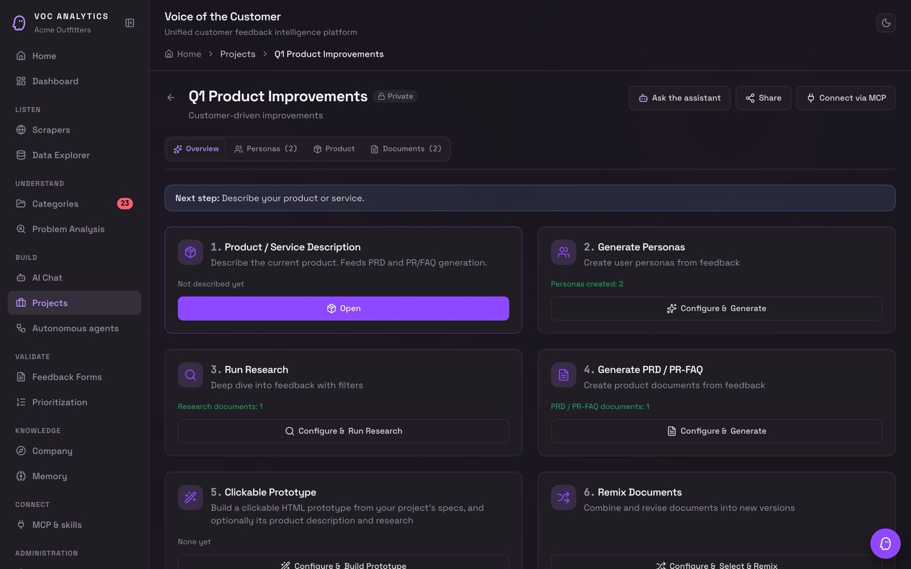
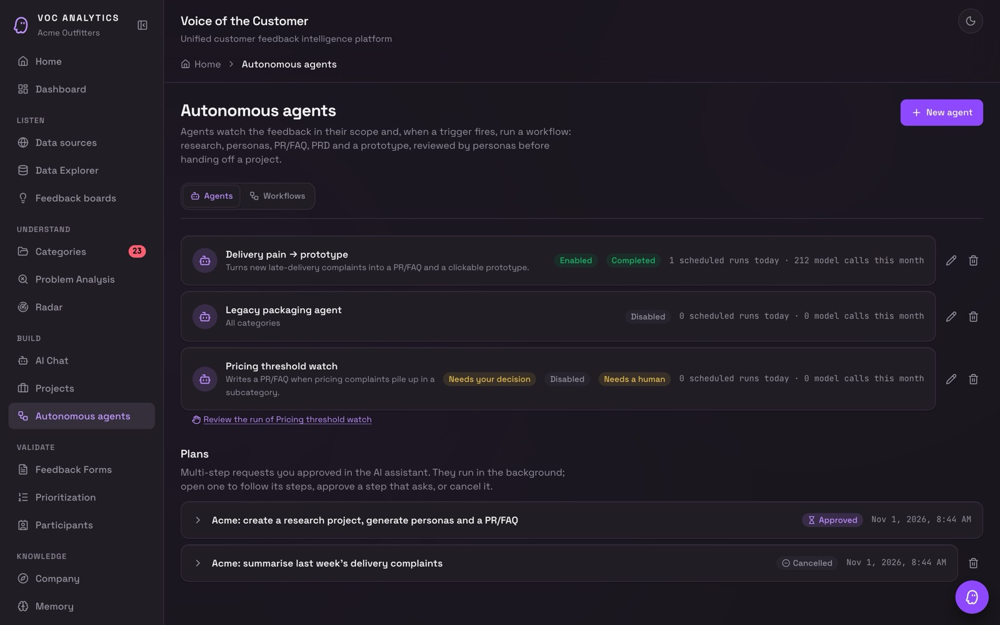
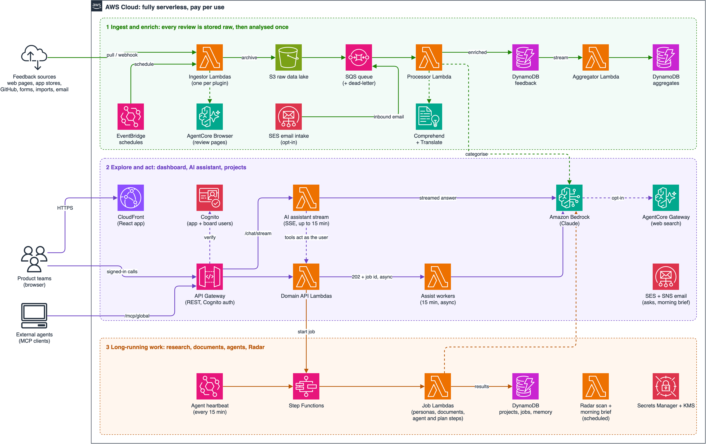

# Voice of Customer (VoC) Data Lake

A serverless AWS sample that collects customer feedback from review sites, app stores, GitHub, imports, forms, email and feedback boards, and enriches every review with Amazon Bedrock, Comprehend and Translate. Product teams then explore the feedback on dashboards and a per-user morning brief, turn it into personas, research, PR/FAQs, PRDs and prototypes, and prioritize the work together. An AI assistant on every page, autonomous agents and an MCP server for external AI tools work on the same data, each with the permissions of the person they act for.



## 📸 Screenshots

The screenshots come from the local mock (`npm run dev`), which serves fictional sample data for "Acme Outfitters".

| | |
|---|---|
|  |  |
| **AI assistant**: one page-aware assistant on every page. It answers from your feedback and cites the reviews it used. | **Categories**: feedback by category, sentiment, keyword and source, filtered by channel, product, user type and tags. |
|  |  |
| **Projects**: describe the product, then generate personas, research, PRD / PR-FAQ documents and a clickable prototype from the evidence. | **Autonomous agents**: agents watch their feedback scope and, when a trigger fires, run a workflow from reviews to a reviewed prototype. |

## ✨ Features

### Collect

- **Data source plugins**: a configurable web scraper, public review pages read with a managed browser (Web Reviews), Apple App Store and Google Play reviews, GitHub Issues with a signed webhook, S3 bulk import and a synthetic review generator ([Plugin Architecture](docs/plugin-architecture.md))
- **Imports**: paste text, upload CSV or JSON, or let the assistant extract reviews from an attached file. A named CSV dataset updates changed rows on re-upload, and every import leaves a run record ([CSV import](docs/csv-import.md), [Import History](docs/import-history.md))
- **Feedback forms**: embeddable forms for your own website or app ([Feedback Forms](docs/feedback-forms.md))
- **Email inbox** (opt-in): customers email `feedback@`, `ideas@`, `bugs@` or `reviews@` your domain through Amazon SES ([Email Inbox](docs/email-intake.md))
- **Feedback boards**: shareable boards for sales requests, service issues or beta feedback, with their own sign-in, +1s and statuses ([Feedback boards](docs/feature-requests.md))
- **Participants**: lists of people to ask for feedback, and emailed asks with unsubscribe ([Participants](docs/participants.md))

### Understand

- **Enrichment**: language detection and translation, then category, sentiment, urgency, persona and dimensions from Claude on Amazon Bedrock ([Processing Pipeline](docs/processing-pipeline.md))
- **Home and the morning brief**: each user's own brief with metric tiles, evidence-linked cards and things to do, optionally emailed ([Morning brief](docs/briefing.md))
- **Dashboard, Categories and Problem Analysis**: feedback by category, sentiment, source and keyword, and a category → subcategory → problem tree over the whole window ([Categories](docs/categories.md), [Problem Analysis](docs/problem-analysis.md))
- **Dimensions, tags and channels**: admin-defined axes such as product, module or user type that filter every page, the assistant and MCP ([Dimensions](docs/dimensions.md))
- **Data quality**: a low / medium / high usefulness band on every review and a per-source profile in the Data Explorer ([Data quality](docs/data-quality.md))
- **Radar**: what other brands' customers love and hate, their news and releases, and a comparison with yours, kept out of your own numbers ([Radar](docs/radar.md))
- **Release watch**: volume and sentiment before and after each release ([Decisions and Release Watch](docs/decisions-and-release-watch.md))

### Act

- **AI assistant**: one page-aware assistant on every page and at `/chat`. Its tools only read; every write is an approval card that runs with your own permissions. It can propose multi-step plans, consult `@personas` about `#documents`, and stays inside the filters on screen ([Plan mode](docs/assistant-plan-mode.md), [Mentions](docs/assistant-mentions.md), [Chat scope](docs/assistant-chat-scope.md))
- **Projects**: personas, research, PR/FAQs, PRDs and clickable prototypes generated from the reviews, and each artifact lists the reviews it was written from ([Project Workspace](docs/project-workspace.md), [Persona Generation](docs/persona-generation.md))
- **Company personas**: a shared persona library that projects copy from and promote into ([Project Workspace](docs/project-workspace.md#company-personas))
- **Document review**: margin comments, "Ask personas to review" and share-for-review links on PR/FAQs and PRDs ([Document review](docs/document-review.md))
- **Ways of working with AI**: per person, Human-driven, AI-assisted or AI-driven writing of PR/FAQs and PRDs, enforced by the API ([Ways of working](docs/ways-of-working.md))
- **Decisions and prioritization**: decision records per project, and Prioritization rows scored on your team's metrics with individual or room votes ([Prioritization](docs/prioritization.md))
- **Autonomous agents**: agents watch a feedback scope and, when a trigger fires, run a workflow from research to a reviewed prototype, with human decision points ([Autonomous Agents](docs/autonomous-agents.md))
- **Memory and company context**: company and personal memory learned from conversations and agent runs, plus the company vision, objectives and design system that ground every output ([Memory](docs/memory.md), [Company Context](docs/company-context.md))

### Extend

- **MCP server**: one endpoint, `/mcp/global`, for Kiro, Claude Code, Cursor and other MCP clients, with OAuth sign-in or personal expiring tokens that act as their owner ([MCP](docs/mcp.md))
- **Your own plugins**: copy the template, then edit a manifest and a handler ([Getting Started with Plugins](docs/getting-started-plugins.md))
- **Project export and import** between deployments ([Moving projects](docs/project-export.md))

### Operate

- **Administration and Account**: six Administration tabs for the software, and an Account page for personal preferences ([Account or Administration](docs/account-vs-admin.md))
- **Model choice**: a Claude model per AI surface over a curated allowlist, a Test button per model, and automatic fallback when a model has no capacity ([Deployment Guide](docs/deployment.md#pinning-all-ai-surfaces-to-one-model))
- **Privacy controls**: per-user category and source access, per-source PII redaction, restricted sources, retention and erasure ([Source Policies](docs/source-policies.md))
- **Diagnostics**: system errors, failure queues and opt-in CloudWatch alarms in Administration → System → Logs ([Deployment Guide](docs/deployment.md#system-errors-administration--system--logs--system-errors))
- **Deployment options**: `protectData` for production, EU-only inference, several copies in one account ([Deployment Guide](docs/deployment.md), [EU Deployment](docs/eu-deployment.md))
- **Security**: Cognito sign-in with opt-in passkeys, least-privilege IAM per Lambda, a customer-managed KMS key, signed CloudFront URLs and Secrets Manager
- **Nine UI languages**: English, Spanish, French, German, Portuguese, Japanese, Chinese, Korean and Polish, chosen on the Account page

## 🏗️ Architecture



Everything is serverless and pay-per-use: Lambda, DynamoDB on demand, S3, SQS, API Gateway, Step Functions and Bedrock. There are no servers or clusters to run. The diagram shows three flows. The editable source is [docs/images/architecture.drawio](docs/images/architecture.drawio); open it in [draw.io](https://app.diagrams.net).

**1. Ingest and enrich.** Each data source is a plugin with its own ingestor Lambda. EventBridge runs it on a schedule; some plugins also accept webhooks. Review pages that need a real browser are read through AgentCore Browser. The ingestor archives every raw item in the S3 data lake (`raw/{source}/{date}/`) before anything else, so data can be reprocessed later. It then queues a reference on SQS. The processor Lambda detects the language and translates (Comprehend, Translate). Bedrock adds the category, urgency, persona and dimensions, and the result is written to the DynamoDB feedback table. A DynamoDB Stream drives the aggregator Lambda, which keeps the daily metrics behind the dashboard up to date.

**2. Explore and act.** The React app is served from CloudFront, and every request is signed in with Cognito. API Gateway routes each path to a small domain Lambda (metrics, projects, settings, …). Each Lambda holds only the permissions its routes need, which also keeps every execution role under IAM's policy size limit. AI requests that can take longer than API Gateway's 29 seconds are handed to an assist worker, a 15-minute copy of the same Lambda. The route answers `202` with a job id at once and the app polls for the result. The AI assistant streams its answers from its own Lambda over server-sent events for up to 15 minutes. Its tools call the domain APIs as the signed-in user, so it can never see more than that user can. External agents reach the same APIs through the MCP server at `/mcp/global`.

**3. Long-running work.** Research, persona generation, document generation, prototypes and autonomous agent runs are Step Functions workflows or background jobs. Their Lambdas call Bedrock and save results and progress to DynamoDB. An agent heartbeat checks agent triggers every 15 minutes. Credentials live in Secrets Manager, and all data is encrypted with a customer-managed KMS key.

The infrastructure is five CDK stacks: `VocCoreStack` (tables, buckets, Cognito, CloudFront, Bedrock model agreements), `VocIngestionStack` (plugins, schedules, queues), `VocProcessingStack` (processor, aggregator, Step Functions, agents), `VocApiStack` (API Gateway, its Lambdas and the website) and `VocWebSearchStack` (the us-east-1 web search gateway). Each plugin is self-contained, with a `manifest.json` that defines its infrastructure, UI config and credentials. See [Plugin Architecture](docs/plugin-architecture.md), [Processing Pipeline](docs/processing-pipeline.md) and [Data Lake Structure](docs/data-lake-structure.md).

## 🚀 Quick Start

You need the AWS CLI with credentials, Node.js 22.12+, Python 3.12+ and Docker or Finch.

```bash
# Clone and install
git clone https://github.com/aws-samples/sample-voice-of-customer-datalake.git
cd sample-voice-of-customer-datalake
npm run install:all
npm install --prefix voc-datalake/lambda/stream   # the AI assistant Lambda (its lint and tests)

# Python environment for the backend lint and tests
cd voc-datalake && python3 -m venv .venv && .venv/bin/pip install -r requirements-dev.txt \
  -r lambda/layers/ingestion-deps/requirements.txt -r lambda/layers/processing-deps/requirements.txt \
  -r lambda/layers/signing-deps/requirements.txt -r lambda/layers/email-intake-deps/requirements.txt && cd ..

# Build Lambda layers (Docker; Finch users: CDK_DOCKER=finch npm run build:layers)
npm run build:layers

# Bootstrap CDK (first time per account and region)
npm run cdk:bootstrap

# Run the quality checks, then deploy every stack and the frontend
npm run deploy:all
```

Web search deploys a stack to us-east-1, so a deployment in another region also needs `cdk bootstrap aws://<account>/us-east-1` (or `-c enableWebSearch=false`). Before the first deploy, file Anthropic's use-case form in the Bedrock console if your account has not done so. The [Deployment Guide](docs/deployment.md) covers both, and the settings for production.

## 🧪 Running the Tests

```bash
npm run test           # frontend Vitest suite
npm run test:cdk       # CDK suite (needs a built frontend: npm run build)
npm run test:stream    # AI assistant stream Lambda
npm run test:backend   # Python pytest suite (needs voc-datalake/.venv, see Quick Start)
npm run check          # lint, type checks, every test suite and the frontend build
```

`npm run dev` starts the frontend against a local mock API with sample data, with no AWS account needed. See [Quality Checks](docs/deployment.md#quality-checks) and [CONTRIBUTING.md](CONTRIBUTING.md) for the full gate.

## 🔐 Initial Login

The first deployment creates an admin user:

| Field | Value |
|-------|-------|
| Username | `admin` |
| Password | The `InitialAdminPassword` output of `VocCoreStack` |

```bash
aws cloudformation describe-stacks \
  --stack-name VocCoreStack \
  --query 'Stacks[0].Outputs[?OutputKey==`InitialAdminPassword`].OutputValue' \
  --output text
```

The site address is the `WebsiteURL` output of the same stack. You are asked to change the password on first sign-in. Later deploys leave the admin user untouched: no new user is created, the password is never reset, and the output shows a placeholder.

## ⚙️ Configuration

Plugins and menu items are switched on or off in `voc-datalake/cdk.context.json`. The committed file turns on every built-in plugin and menu item:

```json
{
  "pluginStatus": {
    "webscraper": true,
    "github_issues": true
  },
  "menuStatus": {
    "radar": true,
    "agents": true
  }
}
```

After a change, run `npm run generate:config`, then deploy: a plugin change needs `npm run deploy:all`, a menu-only change `npm run deploy:frontend`.

Common deploy options, passed as `-c <key>=<value>` (for example `npm run deploy:infra -- -c protectData=true`):

| Option | Effect |
|--------|--------|
| `protectData=true` | Keep tables, buckets, the KMS key and the user pool when the stacks are deleted. Use it for production |
| `inferenceScope=eu` | Keep Bedrock inference in EU regions ([EU Deployment](docs/eu-deployment.md)) |
| `enableWebSearch=false` | Don't deploy the web search gateway (no us-east-1 stack) |
| `emailFrom=<address>` | Send participant asks and board sign-in codes through Amazon SES |
| `inboundEmailDomain=<host>` | Receive feedback by email ([Email Inbox](docs/email-intake.md)) |
| `deploymentPrefix=<letter>` | Run a second, independent copy in the same account and region |
| `defaultModelId=<model id>` | Pin every AI surface to one allowlisted model |

The [Deployment Guide](docs/deployment.md#deploy-options-reference) lists every option.

## 🔌 Built-in Data Sources

| Category | Sources | Plugin id |
|----------|---------|-----------|
| Web pages | Web Scraper (CSS selectors, JSON-LD extraction) | `webscraper` |
| Review sites | Web Reviews: public review pages read with AgentCore Browser | `web_reviews` |
| App stores | iOS App Reviews (Apple App Store), Android App Reviews (Google Play) | `app_reviews_ios`, `app_reviews_android` |
| Issue trackers | GitHub Issues: a scheduled sync plus a signed webhook (`POST /webhooks/github_issues`) | `github_issues` |
| Files | S3 Bulk Import | `s3_import` |
| Workshop data | Synthetic review generator | `synthetic_reviews` |

Manual import (paste, CSV, JSON), feedback forms and the opt-in email inbox are built in and are not plugins. Most plugins stay idle until an administrator gives them something to read: a URL, an app id, a repository and token, or a file.

## 🛠️ Create Your Own Plugin

```bash
cp -r voc-datalake/plugins/_template voc-datalake/plugins/my_source
# Edit manifest.json and handler.py
npm run validate:plugins
```

See [Getting Started with Plugins](docs/getting-started-plugins.md).

## 📊 Tech Stack

| Layer | Technologies |
|-------|-------------|
| Infrastructure | AWS CDK 2 (TypeScript, 5 stacks), Lambda on ARM64 (Python 3.14; Node.js 24 for the AI assistant), DynamoDB, S3, SQS, API Gateway, Step Functions, EventBridge, CloudFront |
| AI/ML | Amazon Bedrock (Claude), Bedrock AgentCore (web search, browser), Comprehend, Translate |
| Frontend | React 19, Vite 7, Tailwind CSS 4, Zustand, TanStack Query, i18next, AWS Amplify (Cognito sign-in) |
| Security | Cognito, IAM, KMS, Secrets Manager, signed CloudFront URLs |

## 📚 Documentation

### Deploy and operate

| Document | Description |
|----------|-------------|
| [Deployment Guide](docs/deployment.md) | Prerequisites, model access, stacks, deploy options, production data protection, diagnostics and troubleshooting |
| [EU Deployment](docs/eu-deployment.md) | `inferenceScope=eu`: EU inference profiles, model availability, web search and avatars, region choice |
| [Account or Administration](docs/account-vs-admin.md) | Where a setting lives: the six Administration tabs and the Account page |
| [Source Policies](docs/source-policies.md) | Source profiles, PII redaction, restricted sources, retention and erasure |
| [Lambda Sizing](docs/lambda-sizing.md) | Memory and timeout policy for every Lambda, and how to check it after a deploy |
| [Read Caching](docs/caching.md) | Version counters, the warm-container read memo and ETag/304: lifetimes, invalidation, how to verify |
| [Moving projects between deployments](docs/project-export.md) | `project-export.py` / `project-import.py`: what is carried, owner matching by email, `--new-ids`, `--dry-run` |

### Features

| Document | Description |
|----------|-------------|
| [Morning brief](docs/briefing.md) | The per-user brief on Home: cards, triggers, cost, email, privacy |
| [Categories](docs/categories.md) | Categories, products, owners, per-user category access and multi-value filters |
| [Problem Analysis](docs/problem-analysis.md) | How `/problems` groups the whole window: grouping, partial and truncated answers |
| [Dimensions](docs/dimensions.md) | Dimensions, tags and channels: model, value sources, filters, API |
| [Data quality](docs/data-quality.md) | The usefulness band, per-source counters and profile, `GET /metrics/data-quality` |
| [Radar](docs/radar.md) | Other brands: love and hate, news and releases from web search, comparison |
| [Decisions and Release Watch](docs/decisions-and-release-watch.md) | Decision records on projects and before/after feedback per release |
| [Project Workspace](docs/project-workspace.md) | Projects, the Product tab, cited reviews, document versions, sharing, company personas |
| [Persona Generation](docs/persona-generation.md) | Adding personas next to the existing ones or replacing them |
| [Document review](docs/document-review.md) | Margin comments, "Ask personas to review", share-for-review links and their sign-in |
| [Ways of working with AI](docs/ways-of-working.md) | Human-driven, AI-assisted and AI-driven PR/FAQ and PRD writing, and how the server enforces it |
| [Prioritization Scoring](docs/prioritization.md) | The workspace scoring setup: metrics, weights, directions, the composite formula, templates, routes |
| [Assistant Plan Mode](docs/assistant-plan-mode.md) | Multi-step requests the assistant proposes and runs after approval |
| [Assistant Mentions](docs/assistant-mentions.md) | `@persona`, `@all` and `#document` in the project assistant |
| [Assistant Chat Scope](docs/assistant-chat-scope.md) | The `/chat` filter panel and the filter floor the assistant's feedback tools cannot read past |
| [Autonomous Agents](docs/autonomous-agents.md) | Agents, triggers, workflows, runs, decisions and plans |
| [Memory](docs/memory.md) | Company and personal memory: extraction, review, recall, retention |
| [Company Context](docs/company-context.md) | Company vision, personal objectives and the design system |
| [Participants](docs/participants.md) | Lists of people to ask for feedback, emailed asks, unsubscribe, attribution, erasure |
| [Feedback boards](docs/feature-requests.md) | Boards per team or audience: templates, fields, audiences, +1s, sign-in, promote to a project |
| [MCP](docs/mcp.md) | The global MCP server: OAuth sign-in, tokens, tools, prompts and resources for external agents |

### Data sources

| Document | Description |
|----------|-------------|
| [Scrapers](docs/scrapers.md) | Web scraper configuration and selector detection |
| [Web Reviews](docs/web-reviews.md) | Reviews from public review pages with a managed browser; blocked sites reported |
| [Mobile App Reviews](docs/mobile-app-reviews.md) | The Apple App Store and Google Play review plugins |
| [GitHub Issues](docs/github-issues.md) | Issues as feedback: sync, webhook, version and label metrics |
| [Feedback Forms](docs/feedback-forms.md) | Embeddable feedback forms |
| [Email Inbox](docs/email-intake.md) | Feedback by email (off by default): SES receiving, guards, threads and dedupe, attachments, domain setup |
| [CSV import](docs/csv-import.md) | CSV row identity, dataset names, previewing and confirming a corrected re-upload |
| [Import History](docs/import-history.md) | One record per paste, CSV, JSON, assistant and S3 import: who, what, counts, warnings |

### Architecture and extending

| Document | Description |
|----------|-------------|
| [Data Lake Structure](docs/data-lake-structure.md) | S3 and DynamoDB organization, and the Data Explorer |
| [Processing Pipeline](docs/processing-pipeline.md) | How feedback flows from ingestion to enriched records and metrics |
| [Plugin Architecture](docs/plugin-architecture.md) | The plugin system's design |
| [Getting Started with Plugins](docs/getting-started-plugins.md) | Creating a new data source plugin |
| [Kiro ACP Browser Bridge](docs/kiro-acp-browser-bridge.md) | Developer tool: send work from a browser to a local `kiro-cli` over ACP, options and threat model |

### Development

| Document | Description |
|----------|-------------|
| [Contributing](CONTRIBUTING.md) | Pull requests, versioning and the quality gates |
| [Kiro Design System](docs/kiro-design-system.md) | Frontend themes, colours, typography, components, motion and UI rules (from KiroCrew) |
| [Code Audit](docs/code-audit.md) | `npm run audit:code`: dead-code, renamed-clone and re-implemented-helper detectors |
| [Coverage Gate](docs/coverage-gate.md) | The per-file coverage floor, its shrink-only baselines, and how to fix a failure |
| [Dependencies](docs/dependencies.md) | Dependabot updates, the license gate, the vulnerability audit and the scheduled-failure watch |
| [Changelog](CHANGELOG.md) | Release notes and upgrade guidance |

## 📄 License

MIT No Attribution - See [LICENSE](LICENSE) for details.
