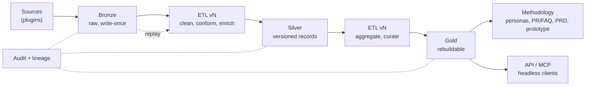

# Tenets

These tenets are the bar every design, pull request and roadmap item in this repository is measured against.

This project shows how Amazon builds products: Working Backwards from real customer evidence to personas, PR/FAQ,
PRD and prototype. It is a teaching tool today and is designed so it could become a managed service tomorrow.

## How to use these tenets

- **They are ranked.** When two tenets conflict, the higher one wins.
- **They are ours unless we know better ones.** To change a tenet, open a pull request that edits this file and
  explains why. Tenets are never changed as a side effect of another change. The same pull request adds the new
  id to `TENET_IDS` in `scripts/pr-checks/tenets.mjs`; because the PR check runs `main`'s copy of that script, the
  pull request that adds a tenet names only ids `main` already knows, and the new id is accepted once it merges.
- **They decide arguments.** If a tenet can't settle a real design disagreement, rewrite it until it can.
- **Every pull request names the tenets it touches** (see [Pull request checklist](#pull-request-checklist)).
- **They are checked, not just read.** See [How the tenets are enforced](#how-the-tenets-are-enforced).

---

## Product tenets (ranked)

### 1. Data first. The data is the product.

The data lake is the core of the tool and the reason it exists. Everything else (methodology, AI, UI, agents) reads
from it. If a feature puts the integrity, lineage or completeness of the data at risk, we drop the feature. We don't
weaken the data.

### 2. The methodology prevails.

The tool teaches the Amazon way of building products: customer evidence → personas → PR/FAQ → PRD → prototype →
review. Workflows follow the methodology's steps and order, and the tool explains why each step matters. No feature,
shortcut or client skips a step without telling the user. Every artifact cites the customer evidence it came from.

### 3. Teach before you accelerate. AI is a dial, not a dependency.

Writing the product documents, the PR/FAQ and the PRD, supports three modes: **Human-driven**, **AI-assisted** and
**AI-driven**, so people learn to write them by hand before they get full AI enablement. The steps are the same in
every mode; AI changes the speed, never the path. The server enforces the mode, not the UI, and an AI never gets
around it by filing the same text under another document type.

Engineering flows (agents that work in a connected repository) follow the same dial: it decides how far a flow
goes. **Human-driven**: the agents find and propose (findings, plans, proposed changes for a person to make); they
push no branch. **AI-assisted**: they write the change on their own branches and open a pull request, and each
step past the plan waits for a person's go. **AI-driven**: they run the flow end to end to a pull request. A pull
request opens ready for review, so a person can approve it as it is, or as a draft when the flow says `pr: draft`;
in every mode only a person approves and merges it: an agent never merges, never approves, never marks a draft
ready and never changes the dial.

Personas, research and prototypes are AI-backed by design, in every mode: people review, edit and correct what the AI
produced, and a persona can also be imported from a file. Everything else keeps working without AI: ingestion,
browsing, metrics and the hand-written documents do not wait for a model.

### 4. Headless by design. The methodology lives in the server, not the screen.

Every capability is available through the API and MCP without the web app. The web app is one client among many
(coding assistants, agents, CLIs, other tools). Methodology rules, AI mode, permissions and audit are enforced
server-side, so a headless client can never do something the UI would refuse.

### 5. Connect to everything. Shape the data later.

We bring in data from as many sources as possible: review sites, app stores, issue trackers, support tickets,
forms, files, email, CRM, transcripts and more. Adding a source means adding a plugin and its manifest, not changing
the platform. We ingest first and model later: a source never waits for a perfect schema.

### 6. Build it as if it is already a service.

Even as a sample, we design for a managed service: tenant isolation, least privilege, infrastructure as code,
serverless pay-per-use, encryption by default, and cost visibility per workload. Customer data outlives any single
deployment or stack.

### 7. Fully serverless. Cost-optimised by default, performance by choice.

The platform runs fully serverless and, by default, with **no fixed monthly cost**: no WAF, no SnapStart, no
provisioned concurrency or capacity, no NAT gateway, no always-on database, cache or container. As a GitHub sample
and a proof of concept, we would rather wait a couple of seconds more than pay to hide a slow path: we make the
Lambda faster (smaller imports, right-sized memory, fewer round trips) before we reach for a paid feature.

Performance features that carry a fixed cost are **opt-in**: a deployment chooses them with one switch,
`-c performanceTier=true` (or each feature's own flag), and gets them tuned for the functions that need them. Run as a
managed service, that tier would be on by default, because we would operate it. Architecturally we build for the service either way (tenet 6); only the bill is opt-in.

Lambda **reserved** concurrency is free (it only caps a function's share of the account) and is allowed by default.
The one accepted baseline is a single customer-managed KMS key (about $1 a month): encryption under a key the
deployment controls is part of tenet 6, which ranks higher.

**How work moves.** Schedules run on EventBridge rules. Long work is a job row plus a worker (an assist twin, a job
Lambda, a Step Functions run), not a model call on a 29-second REST path (the one exception is the admin's one-shot
model test, `POST /settings/model/test`). "Something finished" reaches the browser
as an AppSync Events notice on the person's own channel (pay per use, no fixed cost), and the browser then re-reads
through the API. Polling stays only as the fallback: after a reload, a reconnect or a lost notice, and for callers
that are not the browser. The assistant's live answer streams over SSE (AG-UI on `POST /chat/stream`). MCP stays
request/response: external clients hold no app session, so they read the same job and status routes.

---

## Data lake tenets (non-negotiable)

These put Tenet 1 into practice. For these, the default answer to "can we make an exception?" is **no**.

### D1. Immutable and append-only.

Nothing is overwritten. Corrections, re-categorisations and manual edits create a new version and keep the previous
one. Bronze is no different: an item received again with new content is stored as a new version beside the first.
The history of a record is part of the record.

### D2. Three tiers, each with a contract.

| Tier | Holds | Contract |
| --- | --- | --- |
| **Bronze** (raw) | Every item exactly as received, plus ingestion metadata (source, time, connector version) | Write-once. Never edited, never redacted after the fact. Partitioned by source and date. |
| **Silver** (conformed) | Cleaned, de-duplicated, normalised records in one canonical schema: language, translation, PII handling, category, sentiment, tags, dimensions | Versioned. Every record carries the pipeline version, model and prompt version, and mode (human or AI) that produced it. |
| **Gold** (curated) | Business-ready data: metrics, aggregates, evidence sets, ontology entities, and the inputs to personas, PR/FAQs and PRDs | Always derived. Can be thrown away and rebuilt from Silver at any time. |

Data that is not derived from feedback is not Gold: configuration, access rules, votes, the artifacts people write
and the audit trail are primary data. They are kept, never thrown away, and protected like Silver.

Privacy wins over a full Bronze copy: a source whose profile says *redact* or *summary only* keeps no unredacted
copy, so it can be replayed only from its redacted form (tenet 6 over D2, by decision).

### D3. Replay Raw → Gold at any time.

ETL pipelines are versioned code. Any slice (a source, a date range, a category, or everything) can be reprocessed
from Bronze to Gold with a new pipeline or model version, without losing anything. Reprocessing is a first-class
feature, not a repair script, and old and new outputs can be compared side by side.

### D4. Full audit and lineage.

Every write records who or what made it (user, agent or pipeline), when, why, and with which version. Any Gold
number or document sentence can be traced back to the Silver and Bronze records behind it, and any raw item can be
traced forward to everything derived from it.

### D5. Customer data is never removed. A legal obligation is the only exception.

The lake is the single source of truth, so it does not delete customer data: the raw items in Bronze and the Silver
records derived from them. The only exception is a legal obligation, either a person's erasure request (for example
under GDPR) or a retention limit the deployment is bound to (a contract, a data-processing agreement, a privacy
policy). Either one states its legal basis, is approved and logged, leaves a tombstone, and reaches every derived copy
of the item, because lineage tells us where those copies are.

The workspace artifacts people create (projects, personas, documents, boards, lists, conversations) belong to them:
deleting one really deletes it, the deletion is recorded (D4), and an artifact that cited it says so.

Deleting a whole workspace is its data controller's own request, a retention limit under its agreement with the
deployment: it states its basis, is approved by typing the workspace's slug, is recorded in an audit row, leaves a
tombstone per deleted item, and offers an export first. "Every derived copy" means every copy inside the workspace
that holds the item: a copy another workspace imported is that workspace's own data (D8), and nothing done in the
source reaches it.

### D6. Flexible pipelines, fixed contracts.

Anyone can add, change and chain transformations, enrichments, rules and models. The tier contracts (schema,
versioning, lineage, audit) stay fixed. Flexibility never gets past the contract.

### D7. Discoverable and understood.

Data that nobody can find or understand is worthless. Every dataset and field is catalogued, described and tagged. A
shared ontology (products, features, personas, problems, channels, customers) connects records across sources.
Users and agents can explore, search and discover the data with or without AI.

### D8. Each workspace is its own boundary.

A workspace's data stays in that workspace. Sharing data with another workspace copies it there, and from then on
the copy belongs to the workspace that imported it: nothing done in the source (an edit, an erasure, deleting the
source workspace) reaches it. Each workspace's admins answer for the data it holds. The share step says so before
anything is copied: "it will be copied to <workspace>, which then owns its copy".



---

## Where the platform stands today

The tenets are the bar, and the code does not meet all of them yet. A change must not move further away from a
tenet; closing a gap is a change of its own. Known gaps (2026-11):

| Tenet | Today | Gap |
| --- | --- | --- |
| 2 | Persona generation and research refuse when no feedback matches; generated personas store the reviews they came from. PR/FAQ and PRD generation read feedback unless the request says `feedback: false`. One server module (`lambda/shared/methodology.py`) reports, for every start of research, a PR/FAQ, a PRD or a prototype (REST, assistant, agents, MCP), the upstream steps skipped and the evidence used (persona generation has no upstream step); the block is stored on the document and the project overview lists each step's gaps. A prototype with no PRD or PR/FAQ is refused before its job. Agent runs and approved plans record the block in their journals. Workflow validation warns about a writing step with no evidence, personas or PR/FAQ before it. Hand-written documents carry `evidence: 0`. | Out-of-order steps are reported, not refused (by design, except the prototype); imported and copied personas are marked as carrying no evidence, not refused; hand-written documents cannot cite evidence (they are only marked `evidence: 0`); documents made before 6.04.00 carry no block. |
| 3 | `shared/ai_writing.py` refuses a PR/FAQ or PRD the person's way of working does not allow, on REST, agent, plan and MCP paths. The engineering broker (`engineering/connectors/broker.py`, with `-c engineeringAgents=true`) reads the way of working of the person who started a run before every push and draft pull request: Human-driven, both refused; AI-assisted, both wait for a person's go on the run (an administrator's, `POST /agents/engineering/<run_id>/go`); AI-driven, on to the final go's GO. It fails closed: only an explicitly stored AI-assisted or AI-driven lets a run push, so a person with no saved way of working (AI-driven for documents), a stored mode outside the three and a run that names no person push nothing; in every mode a pull request is a draft and no operation marks one ready or merges. | Not met yet: an AI can save PR/FAQ-shaped text as a `custom` document (MCP `documents_create`, the agent `custom_llm` node, a merge into `custom`); in the assistant's chat the Human-driven rule is a prompt instruction only; when Bedrock is throttled or unavailable, new feedback goes to the dead-letter queue instead of being stored unenriched; in engineering flows only the broker reads the dial: the AI-assisted go is one per run, not one for each step past the plan, and the flows' other steps (and the runtime) do not read the dial yet; no flow has pushed a branch to a real repository yet (since 7.04.00 a push also needs an administrator's CI attestation for the connection and the host's branch rules; the first real run waits for the owner). |
| 4 | Every capability has a REST route; `/mcp/global` delegates to them with the minter's access, including the methodology steps (`projects_generate`, `projects_get_job`), Revise from comments, Radar, feedback edits, the feedback catalogue and source status, Prioritization reads and the minter's own scores, and posting or supporting a feature request. The users API refuses an admin's change to their own role, enabled state or account and the loss of the last admin or the last platform admin, and scraper / app-connector saves refuse an overwriting create and a stale update when the client sends `mode` / `base_etag` (the web app, the assistant and plan steps do). | Admin-only work (imports, source switches, Prioritization axes, board status changes, an engineering run's reports (since 7.53.00 a write token an administrator minted lists, reads, analyses and steers runs and asks for a Run now through five `engineering_` tools, each admitted for its one operation, never as an admin: docs/mcp.md), an engineering run's signals, a person's answers to its agents, a person's board actions on it (post, priority, block, take, move, give back), a person's go on an AI-assisted run, a run's start from a saved engineering flow (`POST /agents/engineering/runs`, the flow page's Start a run and the AI assistant's knowledge refresh card, `propose_knowledge_refresh`, which only an administrator's Approve turns into that start, with their own sign-in), the engineering agents' spend by month (`GET /agents/engineering/spend` and the web app's Agents → Spend tab), the repository connections and their credentials (`GET /agents/engineering/connections`, `PUT`/`DELETE …/connections/<id>`, the web app's Agents → Connections) and the AI assistant's `get_engineering_run`, which reads it with an administrator's own sign-in) has no MCP tool, because an MCP token never acts as an admin; a client that sends neither `mode` nor `base_etag` still upserts a scraper or app connector; the last-admin, last-platform-admin and create / stale-update checks read before they write, so two concurrent requests can both pass. |
| 5 | Plugin roles, schedules and secrets come from the manifest, and so does source-specific behaviour: `capabilities.updatesItems`, `ingestor.jobNotices`, `webhook.memory`. | Still keyed on plugin ids: the GitHub issue analytics (`/metrics/github`, release watch), the multi-instance connector list and validators, the webscraper config check, the s3_import admin API, the design-capture browser reuse, and in the web app the per-plugin copy keys, icons and GitHub panel; the queue schema rejects unknown fields, empty text and a 0 rating; a new plugin fails the gate until it has frontend copy keys in 9 languages. |
| 6 | Customer-managed KMS, a role per Lambda (the processor and the aggregator too), everything in CDK; DynamoDB writes are granted per action, a delete only where the code deletes (`voc-datalake/lib/customer-data-deletes.test.ts`); data is kept when the stacks are deleted (`protectData` is on by default; demos use `-c protectData=false`). | One deployment is one tenant; feedback forms have no owner; reads are still granted per table (`grantReadData`), not per action; cost is visible per stack, and with the engineering module on per engineering flow, run, agent and model (Agents → Spend, session time and, since 7.50.00, model tokens at their prices; the supervisor's role may GetItem the spend partitions and GetItem/UpdateItem the budget alerts' partition, and the board, router and reports roles are denied writes to both); an administrator's hard cap (off by default, one row in voc-agents, `SETTINGS#engineering`, read by the runtime with one GetItem) caps a run's first start at what is left of its flow's month, per run, so concurrent runs of one flow may together pass its budget; every other role that writes voc-agents is denied writes to that partition, and the Agents API, its one writer, may put or update any item of voc-agents, so only its code keeps the hard cap's `LOG#` history rows create-only; the deployment's shared plugin-credentials secret uses the AWS-managed key (a workspace's credentials use the customer-managed key: decision 19, below); with the engineering module on, the engineering runtime's role (a run's retrospective) may put or update any item of the skills' partitions, a `HEAD` row's `current_version` included, and of the roles' lessons partitions (IAM limits it to those partitions; the code writes only the coach's proposal, create-only, with its version counter, and a lesson's draft and confirmations, so a skill change still waits for an administrator's acceptance), and may put any scorecard row (only the code keeps each create-only), until the proposal goes through a narrower writer; and since 7.08.00 the Agents API (an administrator's accept, reject, rollback and benchmark) may put, update and condition-check any item of the skills' partitions (`WS#*#SKILL#*`, no delete), a `HEAD` row's `current_version` and the `LOG#` rows included: IAM limits it to those partitions, and only the skills store's code keeps a version's history create-only and each change conditioned on what the administrator saw. The DeleteItem on `voc-workspaces` of the workspaces API (6.10.00, membership removal) and of the users API (6.11.00, a deleted user's memberships) is pinned to the `WS#*` and `USER#*` partitions, but IAM cannot pin the sort key, so it also reaches a workspace's `META` row: only the code (deleting `MEMBER#` and `USER#` keys alone, under tests) keeps it out. Since 7.14.00 the workspaces API also puts `PLUGIN#*` rows (a workspace's plugin enabled; its DeleteItem there, a disable, since 6.18.00), and the integrations, scrapers and webhook roles read them, `pk` only (a read naming no attributes refused): IAM pins the `PLUGIN#` partition but not the workspace in the sort key, so only the code (the row keyed by the request's resolved workspace, `voc-datalake/lambda/shared/workspace_plugin_settings.py`) keeps an enable, a disable or a run's check to its own workspace (decision 1, soft isolation); likewise `voc-retention`'s UpdateItem of `email` and `name` there (6.11.00) reaches `META`'s `name` in IAM, and the code updates `MEMBER#` rows only; and `voc-workspace-delete`'s (7.28.00, 4d-2, built only with `-c workspaceHardDelete=true`) DeleteItem on `FORM#*`, `PLUGIN#*`, `USER#*` and `WORKSPACES` and its UpdateItem of `SLUG#*` (`deleted_at`) reach every workspace's rows in those partitions in IAM: only the code keeps them to the deleted workspace's (its fixed sort keys, `WS#{ws}` or `META`, and a condition that the row names the workspace, `workspace_id`, under tests); IAM limits the delete role to PROJECT_ID#* keys in voc-projects; it cannot tie an id to the workspace being deleted; the code does (release_project_claim's condition that the claim names this workspace, and the delete only releases ids read from that workspace's own registry); likewise its DeleteItem on `DOCSHARE#*` in voc-projects (7.37.00, a review link's routing row, never read) reaches every link's row, the deployment's own links and other workspaces' routes included: only the code keeps it to the deleted workspace's routes (release_share_route's condition that the row names this workspace, of ids read from that workspace's own link registry). Since 7.48.00 the review registries' marker reset (VocCoreStack, a deploy-time custom resource, `voc-datalake/lib/stacks/review-registries-marker.ts`) may DeleteItem anywhere in voc-projects' `DOCSHARE_IDS` partition, the deployment's link registry included, as IAM cannot pin the sort key: only its one call keeps it to the marker, a row of the backfill's own that holds no customer data, and every audit row is denied to it; its policy is on CDK's singleton AwsCustomResource role, which any other AwsCustomResource of VocCoreStack would share (it is the stack's only one, a test holds it so). The retention worker's Scan of voc-projects (until 3g-d2) answers six attributes of every row, its keys included, and some keys are themselves sensitive: a review link's id, the secret its URL carries, is in `DOCSHARE#<id>` and in the `DOCSHARE_IDS` sort keys, and a reviewer's daily write counter's key (`DCRATE#`) holds a digest of their address; the worker reads them, never logs or stores them. With the same flag, the feedback processor's UpdateItem of `dropped` alone (its count of the messages it dropped, nothing returned) on `WS#<one id>` rows reaches any row of any workspace's control partition in IAM, which cannot pin the sort key; the code adds only to the `WSDELETE_DROPS` counter of the workspace whose message it dropped, and only while that counter exists; it has no access to the job rows. A workspace's credentials (7.12.00, decision 19) are one SSM Parameter Store SecureString per plugin namespace, `/voc/ws/{ws}/credentials/{plugin}`, standard tier (free, at most 4 KB each; a larger save is refused), under the customer-managed key, `/<prefix>-voc/ws/…` in a prefixed deployment; a plugin's scraper or connector list holds no secret and is a voc-aggregates row (`WS#{ws}#PLUGIN_CONFIG`). IAM separates a plugin with a role of its own from the others: that role may read only its own plugin's parameter (`ssm:GetParameter` on `…/ws_<one id>/credentials/{plugin}`; its `kms:Decrypt` through SSM for that name is no second layer, since the role also holds the key unconditioned); the plugins that share `IngestionLambdaRole` may each read the others' parameters, so between them the boundary is the name the code builds from the plugin's own identity; the webhook role reads only its webhook plugins' parameters. It does not separate workspaces: those grants name any one workspace id, so only the code, which builds the name from the run's verified workspace (`lambda/shared/workspace_ids.py` `credentials_parameter_name`) or from the workspace its stored `META` row routes `/webhooks/{plugin}/{ws}` to (`plugins/_shared/base_webhook.py`), keeps a run or a delivery to its own workspace's credentials (decision 1, soft isolation). The export's grants (7.17.00) are held the same way: the export job's role and the workspaces API's reach `ws/<one id>/exports/*` and `WS#<one id>#JOB#export` of any one workspace id, and since 7.20.00 the job's role also lists and reads every object under `ws/<one id>/*` of any one id (the workspace's own files, for its zip), so only the code, which names them from the resolved membership or the job's own row, keeps an export to its own workspace (decision 1, soft isolation). Since 7.22.00 the job's role also Queries one workspace id's company memories, memory imports and `MEMEVT#*` event partitions in `voc-memory`, and may only count (`dynamodb:Select` `COUNT`) its cursors and personal memories; IAM cannot tell a company memory's events from a personal one's (both are keyed by the memory id alone), so only the code, which takes the ids from the company partition, keeps the export from a personal memory's events (`lambda/jobs/workspace_export/test/test_memory.py` checks they are never queried). Since 7.24.00 it also reads one workspace id's list of conversation owners in `voc-conversations` (`WS#<one id>#CONVERSANTS`, for its key alone: `dynamodb:Attributes` `pk` and `sk`, never a row's `first_at`) and may only count (`dynamodb:Select` `COUNT`) its `WS#<one id>#USER#*` partitions: the members' conversations are not exported, only how many people have any is counted; IAM cannot stop a count with no limit from counting a person's conversations, nor one with a filter, a narrower key condition or a start key of its choosing from testing a guess against rows it cannot read (even probing a person's `CONV#` ids), so only the code, which sends one fixed request, `Limit` 1, no filter (`lambda/jobs/workspace_export/test/test_conversations.py` pins it), keeps it a yes-or-no per person. Since 7.39.00 it also Queries the project partitions of any one workspace id: in `voc-projects` the registries (`WS#<one id>#PROJECT_IDS`, `#DOCSHARE_IDS`), the projects' own partitions, document versions and comment partitions (`#PROJECT#*`, `#DOCUMENT_VERSIONS#PROJECT#*`, `#DCOMMENTS#*`) and the review links' rows (`#DOCSHARE#*`), and in `voc-jobs` and `voc-participants` the `WS#<one id>#PROJECT#*` partitions, never a deployment-wide row or a reviewer's counters. The patterns hold the role to that key shape, not to the export's own workspace: only the workspace layer's checks (every partition named from the job's own workspace) hold an export to it. Nor can IAM pin the sort key or the attributes, or tell a deleted project's partitions from a live one's, so the role may read every row there (a series' pointer to its link, a link's id in its key, a version counter's lease, an assist job, a row kind no release lists): only the code reads the listed row kinds, writes each entity's allowlisted or classified-as-exported top-level fields, with its nested maps after a secret-name check (never a link's id, a reviewer's email digest, a credential-shaped attribute or an index key) and exports none of the rows of a project its registry marks deleted (`voc-datalake/lambda/jobs/workspace_export/test/test_projects.py`, `test_project_fields.py`); the objects phase still copies any object left under that project's `ws/<ws>/projects/<id>/` prefix (its uploads, extracted text, prototypes), which the per-project delete (3h) removes with the project. Since 7.43.00 the retention worker may Query the same kind of partitions of any one workspace id in `voc-projects` (`WS#<one id>#PROJECT_IDS`, `#PROJECT#*`, `#DCOMMENTS#*`, `#DOCSHARE_IDS`, `#DOCSHARE#*`) and the platform's `WORKSPACES` listing in `voc-workspaces`, and GetObject a workspace's product documents. The worker's `UpdateItem` on `voc-projects` is held to the attributes the worker writes (`dynamodb:Attributes`) in two statements: the lineage marks' id lists and `erased_evidence` on the deployment's and one workspace id's `PROJECT#*` only (since 7.48.00, when the deployment's lineage pass stopped scanning; any partition before), and the address and name fields the worker rewrites on the deployment's (since 7.48.00) and one workspace id's `PROJECT#*`, `DCOMMENTS#*` and `DOCSHARE#*` only. Since 7.48.00 it also Queries the deployment's own project, comment and link partitions and its three registries (`PROJECT_IDS`, `DOCSHARE_IDS`, `COMMENT_SERIES_IDS`), of the attributes its reads project only and no index, and GetObjects the deployment's product documents' extracted text; it keeps its Scan of `voc-projects` only as the deployment walks' way of finding its links, series and projects until their backfill has run. In plain words, that Scan reads every row of the table, every workspace's included, and is billed for all of them; IAM holds it to the table (no index) and to six attributes of each row (`pk`, `sk`, `workspace_id`, `project_id`, `series_id`, `created_at`: `dynamodb:Select` and `dynamodb:Attributes`), so it can learn every row's key and those few ids across every scope, never a row's content; only the code keeps what it then reads and writes to the deployment's links and series (planned, 3g-d2: the fallback and its grant removed once every deployment has run the backfill). IAM pins the `DOCSHARE#*` update to the key shape, not to the deployment's links: a workspace link's routing row is in reach, and only the code (it updates the links the deployment's registry or its Scan names, never a row naming a workspace) keeps it out. So IAM holds neither the worker's workspace reads nor the worker's workspace writes to one workspace: only the worker's code, which names every partition from a listed or named workspace through the workspace layer (`voc-datalake/lambda/jobs/retention/test/test_project_erasure.py`). Likewise the integrations and scrapers APIs' roles (since 7.12.00) may read and write every plugin's parameters of every workspace (`ssm:GetParameter`, `ssm:PutParameter` on `…/ws_<one id>/credentials/*`, `ssm:GetParametersByPath` on that path, `kms:Decrypt` and `kms:Encrypt` only through SSM for those names): only the code, which names them from the request's resolved workspace and the route's validated plugin (`lambda/shared/workspace_plugin_store.py` `credentials_store`), keeps a request to its own workspace's parameters. These roles also hold the deployment key unconditioned for their other resources (the shared secret, queues, tables), so the SSM-only key statements document the parameters' reach more than they narrow it. Cost per workspace's daily rollup, `voc-cost-rollup` (7.30.00, slice B), may run Logs Insights queries over every `voc-*` Lambda log group of the deployment (`logs:StartQuery` on that name pattern; `logs:GetQueryResults` and `logs:StopQuery` on `*`, which take no resource type), so IAM lets it read any line those Lambdas logged: only the code, which sends one fixed query that keeps the `bedrock_usage` lines and returns their counts by workspace, model and tier (`voc-datalake/lambda/jobs/cost_rollup/test/test_cost_rollup.py` pins it), keeps it to numbers and ids. It writes only the cost rows (PutItem on `WS#<one id>#COST`, `DEPLOYMENT#COST` and `UNATTRIBUTED#COST`) and reads a `META`'s status; the workspaces API may Query those three partitions only (`GET /platform/costs`, platform admins). The product-doc extractor (7.38.00, 3f) holds voc-projects by key only (GetItem and UpdateItem on `PROJECT#*` and `WS#<one id>#PROJECT#*`, the workspace's GetItem held to the five attributes it reads, the UpdateItem held to a document record's `pk`, `sk`, `status`, `error`, `s3_extracted_key` and `extracted_chars`; GetItem of a claim, `PROJECT_ID#*`, held to its key and `workspace_id`) and voc-aggregates' two model rows (GetItem) and reads and writes the product documents of any one workspace id (`ws/<one id>/projects/*/product_docs/raw/*`, read; `…/extracted/*`, put, and deleted only to take back the text of a record deleted mid-extraction, as under `projects/`; in IAM its put and delete reach any project's extracted text in either scope, and only the code holds them to the one key it just wrote): IAM pins neither the sort key nor the workspace, so its UpdateItem reaches those attributes of any row of any workspace's project partitions and its reads any workspace's claims and uploads; only the code, which takes the workspace from the upload's key, goes on only when the project's claim names that same workspace, and updates that document's `PRODUCT_DOC#` row alone (`voc-datalake/lambda/product_doc_extractor/test/test_workspace_uploads.py`), keeps an extraction to its own workspace (decision 1, soft isolation). |
| 7 | No WAF, SnapStart, provisioned capacity, NAT gateway or always-on database, cache or container is on by default (`voc-datalake/lib/fixed-cost-guard.test.ts`); `-c performanceTier=true` turns on SnapStart for four APIs, AWS WAF on the SPA distribution and the API stage (alone: `-c enableWaf=true`) and the Cognito Plus plan (alone: `-c cognitoPlus=true`). | Three Secrets Manager secrets (about $1.20 a month) remain until they move to SSM Parameter Store; the guard counts them and the one KMS key, so neither can grow in the templates, and it allows no role to create a key or a secret at run time (`runtimeFixedCostFindings`). Since decision 19 (7.12.00) a workspace's credentials are one SSM Parameter Store SecureString per plugin namespace, `/voc/ws/{ws}/credentials/{plugin}` (its scraper or connector list is a voc-aggregates row), standard tier: free, at most 4 KB each, each ingestor reading only its own plugin's (one GetParameter a run, within SSM's default of about 40 a second per account and region, a quota the paid higher-throughput setting raises), so a workspace has no fixed cost; polling remains the fallback everywhere, and the web app does not hear about two things yet: a design-reference capture (it still polls every 5 s) and an engineering run in the run monitor (its overview, board and conversation every 5 s, its reports every 15 s, only while the page is open). An engineering run's agents cost only while a run is under way: each runs in its own AgentCore Runtime session (its own microVM), billed per second for the CPU it uses and its memory, ended after an hour idle and at 8 hours, so no session and no committed baseline runs between runs (2 vCPU / 8 GB, at most about $0.39 an hour; the roles that build and test burst to 8 vCPU / 32 GB, at most about $1.48 an hour; and a run's cost cap bounds the run: every run the Agents API starts has one, the deployment's `-c engineeringRunCapUsd`, 50 USD by default, lowered by the hard cap to what is left of its flow's month, and a token cap, `-c engineeringRunTokenCap`, 10 million by default). An ended run's reactions read later (7.10.00) is one one-time EventBridge Scheduler schedule per run with a pull request, which deletes itself once it has run: billed per invocation, nothing standing between runs. The sessions run only in a VPC (`-c engineeringAgentNetwork`, the second wall around their egress: tenet 6 ranks above this one), and that VPC needs a NAT gateway (the package registries and the board's function URL have no VPC endpoint), about $0.045 an hour per Availability Zone in us-east-1 (about $33 a month), plus, recommended, a Bedrock interface endpoint (about $0.01 an hour per zone) and an egress firewall (about $0.395 an hour per zone); the S3 gateway endpoint is free. All of it bills by the hour whether or not a run is under way: a fixed cost of the deployment's own network, outside the stacks and so outside the fixed-cost guard, which only a deployment that turns the agents on pays (docs/deployment.md). The engineering agents' spend (Agents → Spend, the spend ledger) prices session time (each session's vCPU and memory at `-c engineeringSessionRates`, AgentCore's published rates by default) and, since 7.50.00, each model's tokens at its price (`-c engineeringModelPrices`, the AWS Price List's figures by default; a model with no price at the dearest listed, an upper bound), so its dollars, like a run's cost cap, count model spend; a flow's monthly budget is measured on those dollars (alerts to its runs at 80%, 100% and every further 50%, which stop nothing) and enforced only where an administrator turns on the hard cap, once per run at its first start. The tier has no provisioned concurrency, no further SnapStart functions and no DAX yet: those wait for production cold-start and traffic data ([docs/lambda-sizing.md](docs/lambda-sizing.md#the-performance-tier--c-performancetier)). |
| D1 | Raw items are never deleted while the platform runs (outside `voc-retention`); raw objects are write-once (a version per distinct content, `If-None-Match` enforced by the bucket policy) and nothing under `raw/` expires. A workspace's export (7.17.00, docs/multi-workspace.md "Export and delete") is a copy for its admins, not a tier: its zip and work objects under `ws/<ws>/exports/` carry the tag `voc-export=true` and expire 10 days after they are written, and the bucket policy denies that tag on any key outside a workspace's exports, so the rule can never reach `raw/` or `silver/`. | Processed records in `voc-feedback` are still updated in place, but every in-place change that lands (category and dimensions edits, Data Explorer edits, source updates, CSV corrections, reprocessing) also keeps the item as it was before it, write-once, under `silver/{source}/{feedback_id}/`; that write is best-effort (a failed write is logged and counted in `SilverVersionFailures`). Persona edits overwrite the persona. A feedback-board request keeps each enrichment result as a version, but that write is best-effort: a failed write is logged and that result is not kept. |
| D2 | Bronze = the S3 raw bucket (`raw/`); Silver = `voc-feedback`; Gold = the `METRIC#*` rows of `voc-aggregates` (rebuildable with `voc-datalake/scripts/retention/rebuild_aggregates.py`). Every new raw object names the connector (plugin or API writer) and its version (`connector` / `connector-version` metadata). | Items stored before 6.03.00 carry no `pipeline_version` or `enrichment_mode` and keep the prompt version they were made with. `voc-aggregates` also holds primary data (votes, settings, access rules, the erasure audit); Radar counters have no rebuild; a redelivered stream record is reversed once, except that a reversal that times out between its claim and its writes is skipped by the retry (a counter too high), one whose writes fail part-way is retried and moves the counters that had landed again (too low, bounded by the floor), and a claim that cannot be written runs unclaimed; `rebuild_aggregates.py` repairs either drift. While a workspace is `deleting` (7.28.00, 4d-1) the aggregator skips its stream records (counted, `AggregatorInactiveWorkspaceRecordsSkipped`), so its Gold counters stop moving; if the delete is cancelled they no longer match its Silver items (the edits and removals of the fence are missing from them), until its counters are rebuilt: the cancel (7.28.00, 4d-2) marks them for it (`counters_rebuild` on the job row and its audit row), and an operator runs `rebuild_aggregates.py --workspace` once the stream has settled (the script's own rule: a rebuild right after the cancel could count an item still in flight twice). Beside D5's gap of the messages dropped meanwhile. |
| D3 | The category reprocess job replays processed or raw data for a slice: sources, stored categories and a processed- or review-date range (`POST /settings/categories/reprocess`); a job stopped at its limit ends `partial` and resumes from its cursor, and records the configuration it ran with. | A "raw" replay of an import or upload source falls back to the stored text (counted in the job's `raw_fallback`); no side-by-side comparison of old and new outputs; aggregates are rebuilt by an operator script, not a feature. A workspace's reviews (`WS#<ws>#…`, 7.00.00) can be replayed since 7.13.00, by that workspace's own job: the same route with `X-Workspace-Id`, for the workspace's admins (Workspace settings, beside its categories), with the same modes, slices, ceiling and resume; it re-derives only that workspace's reviews (read through the workspace layer) with its own categories and dimensions (the defaults where it saved none, never the deployment's): category and subcategory (processed mode), the processor's full enrichment from the workspace's own bronze `ws/<ws>/raw/` (raw mode: language, translation, sentiment, category, urgency and the rest), or its AI-inferred dimensions, and in every mode the usefulness band; it writes the workspace's own index partitions (`WS#<ws>#CATEGORY#…`, `WS#<ws>#URGENCY#…`) and keeps each old version under `ws/<ws>/silver/`, and the aggregator moves the workspace's own counters from the rewrites (7.04.00). A summary-only review stays summary-only (the PII policy stored on it); the PII policy is not re-applied to text already stored. One job runs per workspace (its lock), beside the deployment's, and a workspace's job and its progress are seen only in that workspace. The deployment's job still leaves every workspace's reviews out. `rebuild_aggregates.py --workspace` still rebuilds a workspace's counters from scratch. |
| D4 | Category and dimension sources (`category_source`, `dimension_sources`); every in-place change to a feedback item stamps `updated_by {sub, kind}` (a person, an admin, an agent, an MCP token or a plan step, told apart), `updated_at` and `change_reason`, and keeps the item as it was under `silver/`; the retention audit, MCP token audit, import history (both kept, no expiry); a workspace's plugin config list (7.17.00) is stamped `updated_by` (the caller's `sub`) and `updated_at`, and every list a save replaces is kept, with who saved and who replaced it, under `WS#{ws}#PLUGIN_CONFIG#HISTORY` (no expiry; a concurrent save is a 409, never a lost entry). | Writes outside feedback items (projects, documents, settings, boards) carry no uniform actor / reason / version record, and REST writes there have no audit trail; a plan step's write is stamped `kind: plan` but its `sub` is the approver's; no end-to-end lineage from a document sentence back to raw items. A workspace config list's history rows (`WS#{ws}#PLUGIN_CONFIG#HISTORY`, 7.17.00) are kept by code only: the operator roles' voc-aggregates grants are table-wide, so IAM does not stop one of them from rewriting or deleting a history row; and they last as long as their workspace: a workspace's hard delete (D5, 4d-2, built only with `-c workspaceHardDelete=true`) removes them with every other `WS#<ws>#` partition, its counts in the platform's `completed` audit row. |
| D5 | Only `voc-retention` deletes feedback, Radar and raw items, for an opt-in retention window or an erasure request (hashed, audited), and a workspace's hard delete one workspace's (below); each states its legal basis (an erasure's `legal_basis`, a profile's `retention_legal_basis`), and every deleted item leaves a contentless tombstone (`AUDIT#tombstone#<source>`) written before the delete. An erased source's uploaded CSV/JSON files go with it, and artifacts that cited an erased item lose its id and carry `erased_evidence`. Participant erasure states its legal basis and records a tombstone and an `AUDIT#delete` row. An erasure by email also reaches the feedback boards: the person's requests and +1s are de-identified (a +1 re-keyed under a new random id) and their opt-in raw copies deleted; and, without a source, the workspace memberships (6.11.00): the email and name on the person's `MEMBER#` rows in `voc-workspaces` are removed, each row tombstoned first. An erasure that deletes any item of a workspace, or de-identifies one of its memberships, also deletes that workspace's exports (7.17.00: its exports marked `erased`, and no link signed, from the moment the erasure first meets the workspace, before anything of it is deleted; then every version under `ws/<ws>/exports/`, its open export upload aborted), since an export is a derived copy (since 7.20.00 it also holds copies of the workspace's current raw and Silver objects, and since 7.22.00 its company memory: its company memories, their events and its memory import rows, while personal memories and extraction cursors are their owners' and only counted, as, since 7.24.00, are its members' conversations (only how many people have any, no conversation total and never their content; two exports compared show whether a given member started using the assistant; no member gets a copy of their own from it, which keeps the workspace's hard delete off (below); its conversations entry finds them through the list of conversation owners, so every writer of them refuses a workspace that is not active before it lists an owner or writes a conversation: since 7.25.00 the stream Lambda reads the status fresh at a run's start and asks again before each session write, so its last write lands within one 15-minute invocation of the mark, inside the delete's 21-minute fence; the chat routes' writes, Stop's marker included (its owner listed first), resolve the workspace from the table on each write; both answer a `deleting` or missing one the one 404); deleting the zip deletes them, and the objects' and memories' own erasure is unchanged). Deleting a user removes their workspace memberships before the account, each removal audited (`AUDIT#WS#`). A whole workspace's hard delete (7.28.00, 4d-2; built only with `-c workspaceHardDelete=true`; since 7.40.00 (owner decision, 2026-11-15) no longer refused until a per-person export ships: it destroys members' conversations and personal memories they hold no copy of, which the web app says before the admin confirms, offering the workspace's export first; decision 17: the data controller's own request, its stated basis checked like an erasure's, the slug typed as approval, the export offered first) is `voc-workspace-delete`'s, the one other role that deletes feedback and raw items, and only one workspace's (every delete and every read of data held in IAM to keys of one workspace id's shape, `WS#<ws>#…` and `ws/<ws>/…`, but its control-plane rows and the project ids' claims: the DeleteItem on `FORM#*`, `PLUGIN#*`, `USER#*` and `WORKSPACES` and the `SLUG#*` UpdateItem cannot be pinned to one workspace by IAM, and only the code keeps them to its own, by fixed sort keys and a `workspace_id` condition, nor can the GetItem and DeleteItem on `PROJECT_ID#*` in voc-projects, which only the code keeps to the claims naming this workspace, or, since 7.37.00, the DeleteItem on `DOCSHARE#*`, which only the code keeps to the review link routes naming this workspace (tenet 6's gap); beyond them it only puts new rows in the `AUDIT#tombstone#…` and `AUDIT#workspace-deletes` partitions (and reads back its own completed row there), updates its own job row (`WSDELETE`), reads the closed counter families' names from the workspace's own `WS#<ws>#SETTINGS#categories` and `#dimensions` rows (never the deployment's), and lists the bucket's open uploads, which is bucket-wide: it can see every open upload's key and id, other workspaces' too, but no data, accepted): after a 21-minute fence it tombstones every item (`AUDIT#tombstone#<source>` / `<ws>#<feedback_id>`) and every memory (`AUDIT#tombstone#memory` / `<ws>#<memory_id>`) before it deletes it, each a put of a new key (an erasure's tombstone of the same item is kept), then deletes every `WS#<ws>#` partition it can list without a Scan, every version and open upload under `ws/<ws>/`, the workspace's credentials parameters, its settings rows (`WS#<ws>#SETTINGS#<kind>`: brand, categories, company context, dimensions, resolved problems, source profiles) and its Radar settings in voc-radar, and its members' objectives rows (a former member's too, from the list each save adds to), its projects (every id its registry lists: since 7.37.00 first the comment partition of each series the project lists, its threads and its review link's pointer, then the partitions keyed by the id in voc-projects, voc-jobs and voc-participants, the document versions included, then the id's claim, released only while it names this workspace, then its registry row, last), since 7.37.00 its review links (every id its link registry lists: the link's routing row, released only while it names this workspace, the link's own row, then its registry row, last), since 7.31.00 its participant lists and people (every list, person and address-guard partition its index `WS#<ws>#PARTICIPANTS` names, then the index, last; no tombstone per contact row: a participant tombstone is keyed by the random person id, not the address, so it never stopped a re-import, and keeping address hashes past the hard delete would be a suppression list that outlives the workspace, D8; an erasure of one person still writes its tombstone), its members' conversations in the workspace (every `WS#<ws>#USER#<sub>` its list of conversation owners names, a former member's too, then that list, last; a person's own `USER#<sub>` outside the workspace is never reached), and its control-plane rows; it keeps `AUDIT#WS#<ws>`, the tombstones, its job row and the platform's `AUDIT#workspace-deletes` rows (requested, cancelled, resumed, completed with counts; never content), and the slug guard, marked deleted and never reused. Its basis is those tombstones and audit rows: the request (who, when, the basis) and what was deleted (counts and ids, never a sub, a session or a conversation id but the requester's). Workspace deletes (projects, personas, documents, boards, lists, conversations, …) remove every S3 version and record an `AUDIT#delete` row (who, what, when); documents written from a deleted source carry `deleted_sources`. No role holds a delete its code does not use, and no role can change or remove an `AUDIT#` row (`voc-datalake/lib/utils/audit-row-guard.ts`). | A retention period saved before 6.00.00 runs with its basis "not recorded" until an admin sets one; a field erasure (author, email, …) keeps a whole-file CSV/JSON upload that also holds other rows and lists it for review; text an artifact derived from an erased review is not rewritten. A daily retention window does not reach a workspace's exports: its deleted items stay in an export until the export expires (10 days). An erasure's sweep of a workspace's exports leaves one window: an export invocation mid-write when the sweep ran may put a work object or a part afterwards, until it reads its row erased at its next hand-over or right before it completes the zip (at most one 15-minute invocation; a row marked after that last check comes before the sweep's abort and delete); it then aborts its upload, never completes, and deletes the work objects it wrote, which leaves their noncurrent versions until the export lifecycle rule removes them a day later. A large CompleteMultipartUpload still running while both sweeps finish can leave its zip until its 10-day expiry (no link is signed for it: its row reads erased). An export invocation the timeout or memory kills inside that window leaves its parts until the 7-day abort of incomplete uploads and its work objects until their 10-day expiry. The `inbound-raw/` copy of each accepted email (unredacted, 90 days, even for a redact source) is outside erasure; an `AUDIT#delete` row of a feedback-board +1 removed before an erasure keeps that +1's email-derived id. A field erasure matches items as stored now, so a value kept only in an older Silver version (an `author` or email a correction replaced) is not reached. An erasure by name (author) does not reach the feedback boards or the workspace memberships: only an erasure by email de-identifies a request's `reporter_name`, a +1's `name` and a membership's `name`; the person's Cognito account (the directory, outside the lake) is not erased by an erasure job, only by deleting the user. An erasure by email and a retention window (since 7.03.00) reach every workspace's matching items too (`WS#<ws>#SOURCE#…` in `voc-feedback`), with their Silver versions (`ws/<ws>/silver/`) and every version of their raw objects (`ws/<ws>/raw/`), each tombstoned first (`AUDIT#tombstone#<source>` / `<ws>#<feedback_id>`, with the workspace); the job counts them (`deleted_workspace_items`). A window binds workspace items because the retention windows stay the deployment's: since 7.08.00 a workspace's messages are processed under its own source profiles, but a workspace profile sets no window (the settings API refuses one) and at ingestion carries the deployment's window for its source; a workspace's source with no profile there redacts personal data by default. A whole-source erasure does not reach them (a request about the deployment's own source), nor does the deployment's erasure by author, source id or CSV row: an author is a display name, not unique even within one source, and an id is unique only within one source account or upload while each workspace has its own. An erasure in one workspace (since 7.09.00: `POST /settings/erasure` with `X-Workspace-Id`, by that workspace's member admin, from Administration inside the workspace) reaches that workspace's items only, by author, source id, CSV row or email, with their copies, each tombstoned first; its job row, in the workspace's own job partition, names the workspace from the resolved membership only (never the body), the worker checks the row names the workspace whose partition it read, and one erasure per workspace runs at a time; it never reaches the deployment's items, another workspace's, Radar, the boards or the memberships (an email erasure in a workspace stays in it: the deployment's still reaches everyone's). A whole-source erasure in a workspace is refused, and a platform admin is not elevated on the erasure routes (they act as a member admin, or not at all). An S3 import's original file (`raw/s3_import/…`, a workspace's `ws/<ws>/raw/s3_import/…`) is linked from no row, so any erasure (of any field: email, author, source id, CSV row, source) that deletes an import's items keeps it and lists that scope's originals folder for review (`files_needing_review`, `lambda/jobs/retention/copies.py`), as it does a whole-file CSV/JSON upload. The deployment's lineage marking finds no workspace item (it leaves a workspace's rows); since 7.43.00 a run that deletes a workspace's item marks that workspace's own artifacts that cite it, through its project registry, never a Scan, and once a run de-identified a board request every listed workspace's artifacts that cite it; since 7.48.00 the deployment's own pass reads its projects through their registry (`PROJECT_IDS`, which a project's delete keeps), or a Scan of their `META` rows until the review registries' backfill has run, and its persona library, each project's partition by Query. An erasure by email reaches neither the memory items (`voc-memory`) nor the assistant conversations (`voc-conversations`), the deployment's or a workspace's: a person's memories, the supporter hashes and the chats that name them stay until those stores gain their own erasure; the gap is older than workspaces. Those rows are keyed by the person's Cognito `sub`, never their email, and what a memory or a message says is not searched. Closing it would take the person's `sub` in the erasure (looked up in the directory while the account exists, or recorded with the request), or their email on those rows, so the job could find their conversations (`USER#<sub>`, and in each workspace through its list of conversation owners, `WS#<ws>#CONVERSANTS`, since 7.19.00) and their personal memories, and a rule for a memory or a message that names the person in its text (docs/multi-workspace.md, "Export and delete"). A workspace's export (7.22.00) holds no conversation and only its company memory, each field from an allowlist that leaves out every supporter hash, embedding, event actor and import starter, with two exceptions for now: a company memory's `conflicts_with` can hold a personal memory's id (an id only, never its content), and a memory event's `detail` is exported whole (an allowlist keyed by the event's action is planned). Since 7.39.00 it also holds the workspace's projects (none exist in a workspace until the switch): each live project's rows, personas, document versions and saved revisions, comment threads, jobs and list links, and the workspace's review links, a project its registry marks deleted skipped and counted; email addresses (a project `META`'s `owner_email` and `members` map, a link's audience, a reviewer's comment) and members' ids are in it as the workspace's own collaboration data, a link's id and a reviewer's email digest never; an erasure that reaches the workspace deletes the zip with them, and since 7.43.00 an erasure by email without a source reaches those addresses themselves in every listed workspace (a workspace's own erasure by email, in that workspace): a link's audience loses the address (a domain in it may still admit the person; a link left admitting nobody is revoked), a reviewer's threads and replies lose the author's email, digest and name, any name field that is the address (an author's, a resolver's, a link's creator or revoker, a persona research note's author) becomes "Team member" (a reviewer's is removed), and a project `META` loses `owner_email` and the email and name of each `members` entry that names the address: the address and name are removed, the sub stays (an access entry, or a thread author's id); each change is recorded before and after, and any such change deletes that workspace's exports; a row that keeps changing fails the job, and an admin reruns it (every step is idempotent). A workspace's product documents are read: one whose filename, text upload or extracted text holds the address is listed for review (`files_needing_review`) and deletes the workspace's exports; one that cannot be judged (an image, never extracted; another kind; unreadable or too large text) is listed apart (`files_not_checked`, on the job and audit rows only until the erasure panel shows it, slice 3g-ui) and does not close the exports, so its copy in an export's zip stays until the zip expires (10 days); nothing there is changed or deleted. A walk of every listed workspace reaches one renamed or created while it runs: a rename stamps the listing row it moves, and when the listing ends the walk reads again, strongly consistent, the rows stamped since it began and walks those workspaces again (at most three passes, then the job fails and an admin reruns it); a rename landing between two pages of the last pass that moves its row behind them (a listing over 1 MB) is still not walked. Not reached: thread text that names the person (not searched); the reviewer's board-pool account, which keeps their email (a gap older than workspaces: the planned slice 3g-r has an erasure by email delete, or list for review, the board-pool user with that address); a member's address, which re-adding the member, or making them owner, copies again from the user directory (a member's complete erasure is deleting the user); and the reviewers' daily write counters (`DCRATE#`), whose key holds an unsalted, pseudonymous digest of the address for their two days. Since 7.48.00 the same erasure by email (the deployment's job) reaches the deployment's own projects, where every real reviewer address is today, by the same de-identification: every deployment review link, a revoked one too, through the deployment's link registry (`DOCSHARE_IDS`), every comment partition, a deleted project's too (its delete leaves its threads), through the deployment's series registry (`COMMENT_SERIES_IDS`), and every project's `META`, personas and product documents, a deleted or half-deleted project's too, through the deployment's project registry (`PROJECT_IDS`, which its delete keeps); the project create, the link create and a series' first thread write those registries, and a backfill (run once by an operator, safe to run again) lists what was made before; until it has run, the erasure finds the same rows by its own Scans. Either way it reaches every row the stores had written when it read that part (provided every writer since the backfill ran 7.48.00 or later: a VocApiStack-only rollback below 7.48.00, or a bundle imported from an older checkout, breaks this until `--unmark`; a thread written to a series it already walked is the next erasure's). A deployment's product document is judged by its extracted text, whatever its kind (a PDF's text, an image's description), and one with no text yet (pending, failed) is listed as not checked. A deleted or half-deleted deployment project's product documents folder is listed as not checked (an object its delete could not remove outlives its record). An erasure by email that did not reach the deployment's projects keeps only the address's hash, so an admin runs again every erasure by email without a source created before the 7.48.00 deploy finished, or whose row does not say `deployment_projects_walked: true` (since 7.48.00 only the deployment's erasure by email without a source carries that field). The general gaps above apply to the deployment's projects as to a workspace's: the reviewers' `DCRATE#` counters, thread text that names the person (never searched) and the board-pool account. Still not reached: a deployment project's delete (`delete_project`) empties the project's partition but leaves its comment threads and its review links, which keep reviewers' addresses with no `ttl` on the threads (an erasure by email reaches them through the registries; the delete itself does not; planned, 3g-p: the delete sweeps the comment partitions `COMMENT_SERIES_IDS` names for the project and its links, then prunes those registry rows), and `DOCSHARE_IDS` keeps each link's raw id, the secret its URL carries, after the link expires; the project bundles an operator exports (`voc-datalake/scripts/project-export.py`) copy a project's threads, reviewer addresses included, into files on the operator's machine that no erasure reaches (delete a bundle once it is imported); a prototype pin's reply (`PINS#` in voc-aggregates) names a member by their username, or their address when they have none, and no erasure reaches it (since 7.48.00 a reply names the username, else "Team member": the older replies are 3g-pin); and the lineage marks read neither an id cited inside a document's `derivation` (its `input_feature_request_ids` there) nor a persona job's `result` in voc-jobs, which holds the persona's lineage ids until the job row's 7-day `ttl` (3g-lin1, 3g-lin2; the bundle files are 3g-bundle); nor the review ids the engineering agents' runs keep (since 7.47.00: an engineering run's `feedback.ids` on its `META` in voc-engineering and an `ISSUE_RUN#` claim's `feedback_id` in voc-agents, neither with a `ttl`; the agent run row keeps only a `feedback_count`), ids only, never content (3g3). The workspace's participant lists and people are not in the export yet. A workspace being deleted (7.28.00, 4d-1: status `deleting`) has its in-flight queue messages dropped by the processor, acked and counted (`WorkspaceMessagesDropped`), not tombstoned: they never became items, so there is nothing to tombstone, and a cancel of the delete does not bring them back (with the hard delete built, the processor adds each batch's drops to the workspace's own drop counter, and the cancel's and the completed audit rows, 4d-2, report at least that many, a lower bound; the skipped counter updates beside them are D2's gap). A workspace's hard delete (4d-2) leaves, by design or until they expire: point-in-time backups and logs (until their retention ends), the processing claims in `voc-idempotency` (no content, not listable without a Scan, until their two-day TTL), a workspace's `LOGS#` rows of a source no stored item or plugin names (until their TTL), a counter row of an open family's value (a tag, a channel or another value that no stored item, no metric-type index and no configured category, subcategory, dimension or sentiment label names any more: its counts and that value in its key, until the counters' 90-day TTL; nothing lists its partition without a Scan), and a watermark written before 4d-1 (no directory row; workspace runs are new, so none on a fresh deployment). An erasure by email does not reach voc-participants: a participant is erased by its person id only (`DELETE /participants/people/{id}`), so the same address in two workspaces is two unrelated people, each erased on its own (the plan's 3g2, before the switch, has the deployment's erasure by email look the address up in each workspace's guard). Older than workspaces: promoting a board request to planned makes each of its supporters a participant (`feature_requests_promote.py` runs `upsert_person` for each), so an erasure of that person by id leaves their board +1s, and the next promote re-creates the erased participant; 3g2 closes this too. Since 7.37.00 it reaches a project's comment threads (through the series its partition lists) and the workspace's review links (through their registry), none written in a workspace yet; a reviewer's daily write counters on a link (`DCRATE#…`, keyed by an unsalted, pseudonymous digest of the address) are not reached by an erasure and are left to their two-day TTL; its MCP tokens name no workspace until phase 3. Nor does it reach voc-radar's data rows in a workspace (items, review markers, counters, releases: read with a workspace, written by nothing yet). The counters of a category the deployment configured before 7.08.00 (a workspace's items were enriched with the deployment's categories then) whose items were all erased before the delete are kept, with that name in their key, until the counters' 90-day TTL. The engineering agents' memory (`voc-engineering`, only with `-c engineeringAgents=true`) has an erasure of its own, `erase_person_memories` (`voc-datalake/lambda/engineering/agent_memory/store.py`: a tombstone and an `AUDIT#delete` row, then the person's id de-identified in other scopes' rows and their own partition deleted), but it is only an administrator's call on the store, which no route or job makes yet; the voc-retention erasure never reaches the agents' memory. |
| D6 | Enrichments, categories, dimensions and tags are configurable without code changes. | The contracts that flexibility must respect are themselves incomplete (D2 versions, D4 audit), so nothing yet stops a new transformation from writing without them. |
| D7 | Dimensions, tags and categories are configured and documented (`docs/dimensions.md`); the processed feedback item has a machine-readable catalogue (`GET /feedback/catalogue`, [docs/data-catalogue.md](docs/data-catalogue.md)) that a test keeps in step with every writer, served to MCP (`feedback_get_catalogue`) and shown in Data Explorer → Fields. | The catalogue covers `voc-feedback` only (not projects, documents or aggregates); there is no shared ontology. |
| D8 | A request names its workspace (`X-Workspace-Id`), and a member of another workspace gets the one 404 on every workspace-scoped route (`voc-datalake/lambda/api/test/test_cross_workspace_routes.py`); a workspace's feedback, dashboards, brand and resolved problems are its own (7.04.00), and so are its feedback forms and its webhook endpoints (7.06.00), which route by workspace from a stored row (`FORM#{id}`, the workspace's `META`), and its categories, dimensions and source profiles (7.08.00: its admins edit them, its feedback is processed, ingested and read with them, a workspace that saved none gets the defaults, with its sources' PII redacted, and never the deployment's rows); and since 7.14.00 its own ingestion (the hold lifted): its admins enable its plugins (`PLUGIN#{plugin}` / `WS#{ws}`, audited first), the scheduled tick fans out to the workspaces that enabled each, Run now and a scraper's run there run only an enabled plugin (409 otherwise), its webhooks take a delivery only for an enabled plugin (the bad signature's 401 otherwise, so a disable stops them too), a deployment-only plugin (the S3 import) is not offered to it, and its forms' submissions and its webhooks' deliveries land in it, every item under `WS#{ws}#…` and `ws/{ws}/raw/`, aggregated, erasable (D5, 7.03.00 and 7.09.00) and replayable (D3, 7.13.00) in it (`voc-datalake/lambda/jobs/test/test_workspace_cross_path.py`); and since 7.15.00 its members' assistant conversations (`WS#{ws}#USER#{sub}`, checked by both writers) and its memories (`WS#{ws}#MEM…`, its admins curating, swept by memory retention), judged against its own categories, learned since 7.16.00 from its own conversations and imported pages (while the owner is an editor or an admin there) and tagged with its own categories; all behind the repository layer (`voc-datalake/lambda/shared/ws_repo.py`) and the raw-access guard. | Projects, Radar's writers, agents and the other settings are still shared by the deployment (phase 3), so a workspace's memories are still linked to the deployment's company objectives until company context moves per workspace; a workspace's processing logs are written under its own keys, but the logs routes still read only the deployment's trail until the logs cut-over; still the deployment's too: email intake, voting sessions and the S3 and manual imports; the retention windows stay the deployment's for every workspace's items; a workspace cannot erase a whole source of its own yet (phase 4: a whole-source erasure stays the deployment's request); sharing between workspaces is not built yet (phase 5: the import plugin, which copies and says so in the share step). |

---

## How the tenets are enforced

The same checks run locally and on GitHub, so a green local run means a green pipeline.

- **Pull request description** (`scripts/pr-checks/check-pr-body.mjs`, the `PR description` workflow): every PR has a
  `## Tenets` section with a `Tenets touched:` line naming the tenets it touches (`1`–`7`, `D1`–`D8`) or `none`.
- **No fixed cost by default** (tenet 7, `voc-datalake/lib/fixed-cost-guard.test.ts`, part of `scripts/validate.sh`):
  the default synth of every stack fails on a WAF, SnapStart, provisioned concurrency or capacity, a NAT gateway, an
  Elastic IP, an interface VPC endpoint, an always-on database, cache, cluster or container, a Global Accelerator, an API Gateway cache, a CloudFront dedicated IP or a created hosted zone.
  Opt-in flags list exactly the fixed costs they add. The same gate counts the resources billed per resource per
  month: exactly one customer-managed KMS key, and the three Secrets Manager secrets as a baseline that can only
  shrink (`COUNTED_FIXED_COSTS` in `voc-datalake/lib/test-support/fixed-cost-rules.ts`). No role may create a key or
  a secret at run time (`runtimeFixedCostFindings`, same file): a workspace's credentials are SSM Parameter Store
  SecureStrings, standard tier, with no monthly fee (docs/multi-workspace.md, decision 19).
- **Data deletion** (D5): `voc-datalake/lib/customer-data-deletes.test.ts` pins every role that may delete from
  `voc-feedback` or `raw/` (`voc-retention`, plus legacy grants that can only shrink); every mutating API route is
  classified admin-only or open-by-decision (`voc-datalake/lambda/api/test/test_route_admin_gates.py`), and the
  Data Explorer has no delete route.
- **Server-side AI mode** (tenet 3): `voc-datalake/lambda/shared/ai_writing.py` refuses a PR/FAQ or PRD the person's
  way of working does not allow, on the REST, agent, plan and MCP paths; the engineering broker
  (`voc-datalake/lambda/engineering/connectors/broker.py`, `dial.py`) reads the run starter's way of working before
  every push and pull request, with a test for each mode.
- **Tenets AI review** (`scripts/ai-review/review.mjs --kind tenets`, the `tenets: AI review` step of
  `scripts/validate.sh`): the developer's own coding agent (`kiro-cli`, else `claude`) reads the change since
  `origin/main` against this file and fails the step on a grounded violation. It holds no credential; without either
  CLI, or on CI, it is skipped ([CONTRIBUTING.md](CONTRIBUTING.md#ai-reviews-in-validatesh)). On GitHub the same
  prompt reviews every pull request (the `AI review` workflow, `scripts/ai-review/ci-review.mjs`) and posts its
  verdict as a comment; it is advisory and fails no check.
- **Reviews**: the pre-push AI review (`scripts/git-hooks/pre-push`, `.kiro/agents/`) and every Kiro agent working in
  this repository (`.kiro/steering/tenets.md`) check a change against these tenets and report a violation as a
  blocking finding.
- **This file itself**: `scripts/pr-checks/tenets.test.mjs` pins that the ids the checklist and the PR check use are
  exactly the tenets defined here.

---

## Pull request checklist

Copy into the pull request description and answer every line that applies.

```markdown
## Tenets

Tenets touched: <!-- e.g. 3, D1, D4 — or "none" -->

- [ ] Data: nothing in Bronze is changed or deleted; Silver changes create new versions (D1, D2)
- [ ] Replay: the change can be reprocessed from Bronze and records its pipeline/model version (D3)
- [ ] Audit: new writes record actor, time, reason and version (D4)
- [ ] No new delete path for customer data outside a legal obligation; workspace deletes are recorded (D5)
- [ ] Workspaces: a workspace's data is read and written only in that workspace; a share copies and says so (D8)
- [ ] Methodology: no step can be skipped silently; artifacts cite their evidence (2)
- [ ] AI modes: PR/FAQ and PRD writing follows the person's mode, enforced server-side; the rest works without AI (3)
- [ ] Headless: available and enforced via the API/MCP, not only the UI (4)
- [ ] Cost: no new fixed monthly cost by default; a performance feature is opt-in behind a flag (7)
- [ ] Trade-off: if this weakens a lower tenet to serve a higher one, explain it here
```
