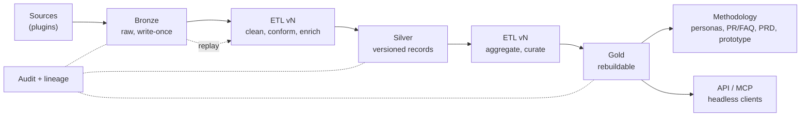

# Tenets

These tenets are the bar every design, pull request and roadmap item in this repository is measured against.

This project shows how Amazon builds products: Working Backwards from real customer evidence to personas, PR/FAQ,
PRD and prototype. It is a teaching tool today and is designed so it could become a managed service tomorrow.

## How to use these tenets

- **They are ranked.** When two tenets conflict, the higher one wins.
- **They are ours unless we know better ones.** To change a tenet, open a pull request that edits this file and
  explains why. Tenets are never changed as a side effect of another change.
- **They decide arguments.** If a tenet can't settle a real design disagreement, rewrite it until it can.
- **Every pull request names the tenets it touches** (see [Pull request checklist](#pull-request-checklist)).
- **They are checked, not just read.** See [How the tenets are enforced](#how-the-tenets-are-enforced).

---

## Product tenets (ranked)

### 1. Data first. The data is the product.

The data lake is the core of the tool and the reason it exists. Everything else (methodology, AI, UI, agents) reads
from it. If a feature puts the integrity, lineage or completeness of the data at risk, we drop the feature. We don't
weaken the data.

### 2. The methodology prevails.

The tool teaches the Amazon way of building products: customer evidence → personas → PR/FAQ → PRD → prototype →
review. Workflows follow the methodology's steps and order, and the tool explains why each step matters. No feature,
shortcut or client skips a step without telling the user. Every artifact cites the customer evidence it came from.

### 3. Teach before you accelerate. AI is a dial, not a dependency.

Every workflow supports three modes: **Human-driven**, **AI-assisted** and **AI-driven**. AI can be switched off
completely and the tool still works end to end, so people learn the methodology by hand before they get full AI
enablement. The steps are the same in every mode; AI changes the speed, never the path. The server enforces the
mode, not the UI.

### 4. Headless by design. The methodology lives in the server, not the screen.

Every capability is available through the API and MCP without the web app. The web app is one client among many
(coding assistants, agents, CLIs, other tools). Methodology rules, AI mode, permissions and audit are enforced
server-side, so a headless client can never do something the UI would refuse.

### 5. Connect to everything. Shape the data later.

We bring in data from as many sources as possible: review sites, app stores, issue trackers, support tickets,
forms, files, email, CRM, transcripts and more. Adding a source means adding a plugin and its manifest, not changing
the platform. We ingest first and model later: a source never waits for a perfect schema.

### 6. Build it as if it is already a service.

Even as a sample, we design for a managed service: tenant isolation, least privilege, infrastructure as code,
serverless pay-per-use, encryption by default, and cost visibility per workload. Customer data outlives any single
deployment or stack.

### 7. Fully serverless. Cost-optimised by default, performance by choice.

The platform runs fully serverless and, by default, with **no fixed monthly cost**: no WAF, no SnapStart, no
provisioned concurrency or capacity, no NAT gateway, no always-on database, cache or container. As a GitHub sample
and a proof of concept, we would rather wait a couple of seconds more than pay to hide a slow path: we make the
Lambda faster (smaller imports, right-sized memory, fewer round trips) before we reach for a paid feature.

Performance features that carry a fixed cost are **opt-in**: a deployment chooses them with one switch,
`-c performanceTier=true` (or each feature's own flag), and gets them tuned for the functions that need them. Run as a
managed service, that tier would be on by default, because we would operate it. Architecturally we build for the service either way (tenet 6); only the bill is opt-in.

Lambda **reserved** concurrency is free (it only caps a function's share of the account) and is allowed by default.

---

## Data lake tenets (non-negotiable)

These put Tenet 1 into practice. For these, the default answer to "can we make an exception?" is **no**.

### D1. Immutable and append-only.

Nothing is overwritten. Corrections, re-categorisations and manual edits create a new version and keep the previous
one. The history of a record is part of the record.

### D2. Three tiers, each with a contract.

| Tier | Holds | Contract |
| --- | --- | --- |
| **Bronze** (raw) | Every item exactly as received, plus ingestion metadata (source, time, connector version) | Write-once. Never edited, never redacted after the fact. Partitioned by source and date. |
| **Silver** (conformed) | Cleaned, de-duplicated, normalised records in one canonical schema: language, translation, PII handling, category, sentiment, tags, dimensions | Versioned. Every record carries the pipeline version, model and prompt version, and mode (human or AI) that produced it. |
| **Gold** (curated) | Business-ready data: metrics, aggregates, evidence sets, ontology entities, and the inputs to personas, PR/FAQs and PRDs | Always derived. Can be thrown away and rebuilt from Silver at any time. |

### D3. Replay Raw → Gold at any time.

ETL pipelines are versioned code. Any slice (a source, a date range, a category, or everything) can be reprocessed
from Bronze to Gold with a new pipeline or model version, without losing anything. Reprocessing is a first-class
feature, not a repair script, and old and new outputs can be compared side by side.

### D4. Full audit and lineage.

Every write records who or what made it (user, agent or pipeline), when, why, and with which version. Any Gold
number or document sentence can be traced back to the Silver and Bronze records behind it, and any raw item can be
traced forward to everything derived from it.

### D5. Data is never removed. Lawful erasure is the only exception.

The lake is the single source of truth, so it does not delete data. The only exception is a legally required
erasure (for example under GDPR). An erasure is explicit, approved and logged, leaves a tombstone, and reaches every
derived copy of the item, because lineage tells us where those copies are.

### D6. Flexible pipelines, fixed contracts.

Anyone can add, change and chain transformations, enrichments, rules and models. The tier contracts (schema,
versioning, lineage, audit) stay fixed. Flexibility never gets past the contract.

### D7. Discoverable and understood.

Data that nobody can find or understand is worthless. Every dataset and field is catalogued, described and tagged. A
shared ontology (products, features, personas, problems, channels, customers) connects records across sources.
Users and agents can explore, search and discover the data with or without AI.



---

## Where the platform stands today

The tenets are the bar, and the code does not meet all of them yet. A change must not move further away from a
tenet; closing a gap is a change of its own. Known gaps (2026-11):

| Tenet | Today | Gap |
| --- | --- | --- |
| D1 | Raw items in S3 (`raw/`) are write-once and never deleted while the platform runs. | Processed records in `voc-feedback` are updated in place (category corrections, reprocessing, dimensions): the previous value is not kept as a version. |
| D2 | Bronze = the S3 raw bucket; Silver = `voc-feedback`; Gold = `voc-aggregates` (rebuildable with `voc-datalake/scripts/retention/rebuild_aggregates.py`). | Silver records do not yet carry pipeline / model / prompt versions or the mode that produced them. |
| D3 | The category reprocess job replays processed or raw data for a window (`POST /settings/categories/reprocess`). | No side-by-side comparison of old and new outputs; aggregates are rebuilt by an operator script, not a feature. |
| D4 | Category and dimension sources (`category_source`, `dimension_sources`), the retention audit, MCP token audit. | No uniform actor / reason / version record on every write; no end-to-end lineage from a document sentence back to raw items. |
| D5 | Only `voc-retention` deletes customer data, and only for an opt-in retention window or an erasure request (hashed, audited). | Retention by source profile is a delete outside lawful erasure; erasure does not yet leave a tombstone in every derived copy. |
| D7 | Dimensions, tags and categories are configured and documented (`docs/dimensions.md`). | No data catalogue or shared ontology yet. |
| 7 | Nothing with a fixed monthly cost is on by default (`voc-datalake/lib/fixed-cost-guard.test.ts`); `-c performanceTier=true` turns on SnapStart for four APIs. | The tier has no provisioned concurrency, no further SnapStart functions and no DAX yet: those wait for production cold-start and traffic data ([docs/lambda-sizing.md](docs/lambda-sizing.md#the-performance-tier--c-performancetier)). |

---

## How the tenets are enforced

The same checks run locally and on GitHub, so a green local run means a green pipeline.

- **Pull request description** (`scripts/pr-checks/check-pr-body.mjs`, the `PR description` workflow): every PR has a
  `## Tenets` section with a `Tenets touched:` line naming the tenets it touches (`1`–`7`, `D1`–`D7`) or `none`.
- **No fixed cost by default** (tenet 7, `voc-datalake/lib/fixed-cost-guard.test.ts`, part of `scripts/validate.sh`):
  the default synth of every stack fails on a WAF, SnapStart, provisioned concurrency or capacity, a NAT gateway, an
  always-on database, cache or container, an API Gateway cache, a CloudFront dedicated IP or a created hosted zone.
  Opt-in flags list exactly the fixed costs they add.
- **Data deletion** (D5): a delete of customer data needs the `voc-retention` role; every mutating API route is
  classified admin-only or open-by-decision (`voc-datalake/lambda/api/test/test_route_admin_gates.py`), and the
  Data Explorer has no delete route.
- **Server-side AI mode** (tenet 3): `voc-datalake/lambda/shared/ai_writing.py` refuses AI writes the person's way of
  working does not allow, on every path (REST, assistant, agents, MCP).
- **Reviews**: the pre-push AI review (`scripts/git-hooks/pre-push`, `.kiro/agents/`) and every Kiro agent working in
  this repository (`.kiro/steering/tenets.md`) check a change against these tenets and report a violation as a
  blocking finding.
- **This file itself**: `scripts/pr-checks/tenets.test.mjs` pins that the ids the checklist and the PR check use are
  exactly the tenets defined here.

---

## Pull request checklist

Copy into the pull request description and answer every line that applies.

```markdown
## Tenets

Tenets touched: <!-- e.g. 3, D1, D4 — or "none" -->

- [ ] Data: nothing in Bronze is changed or deleted; Silver changes create new versions (D1, D2)
- [ ] Replay: the change can be reprocessed from Bronze and records its pipeline/model version (D3)
- [ ] Audit: new writes record actor, time, reason and version (D4)
- [ ] No new delete path for customer data outside lawful erasure (D5)
- [ ] Methodology: no step can be skipped silently; artifacts cite their evidence (2)
- [ ] AI modes: works with AI off; the mode is enforced server-side (3)
- [ ] Headless: available and enforced via the API/MCP, not only the UI (4)
- [ ] Cost: no new fixed monthly cost by default; a performance feature is opt-in behind a flag (7)
- [ ] Trade-off: if this weakens a lower tenet to serve a higher one, explain it here
```
