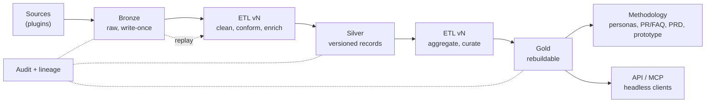

# Tenets

These tenets are the bar every design, pull request and roadmap item in this repository is measured against.

This project shows how Amazon builds products: Working Backwards from real customer evidence to personas, PR/FAQ,
PRD and prototype. It is a teaching tool today and is designed so it could become a managed service tomorrow.

## How to use these tenets

- **They are ranked.** When two tenets conflict, the higher one wins.
- **They are ours unless we know better ones.** To change a tenet, open a pull request that edits this file and
  explains why. Tenets are never changed as a side effect of another change. The same pull request adds the new
  id to `TENET_IDS` in `scripts/pr-checks/tenets.mjs`; because the PR check runs `main`'s copy of that script, the
  pull request that adds a tenet names only ids `main` already knows, and the new id is accepted once it merges.
- **They decide arguments.** If a tenet can't settle a real design disagreement, rewrite it until it can.
- **Every pull request names the tenets it touches** (see [Pull request checklist](#pull-request-checklist)).
- **They are checked, not just read.** See [How the tenets are enforced](#how-the-tenets-are-enforced).

---

## Product tenets (ranked)

### 1. Data first. The data is the product.

The data lake is the core of the tool and the reason it exists. Everything else (methodology, AI, UI, agents) reads
from it. If a feature puts the integrity, lineage or completeness of the data at risk, we drop the feature. We don't
weaken the data.

### 2. The methodology prevails.

The tool teaches the Amazon way of building products: customer evidence → personas → PR/FAQ → PRD → prototype →
review. Workflows follow the methodology's steps and order, and the tool explains why each step matters. No feature,
shortcut or client skips a step without telling the user. Every artifact cites the customer evidence it came from.

### 3. Teach before you accelerate. AI is a dial, not a dependency.

Writing the product documents, the PR/FAQ and the PRD, supports three modes: **Human-driven**, **AI-assisted** and
**AI-driven**, so people learn to write them by hand before they get full AI enablement. The steps are the same in
every mode; AI changes the speed, never the path. The server enforces the mode, not the UI, and an AI never gets
around it by filing the same text under another document type.

Personas, research and prototypes are AI-backed by design, in every mode: people review, edit and correct what the AI
produced, and a persona can also be imported from a file. Everything else keeps working without AI: ingestion,
browsing, metrics and the hand-written documents do not wait for a model.

### 4. Headless by design. The methodology lives in the server, not the screen.

Every capability is available through the API and MCP without the web app. The web app is one client among many
(coding assistants, agents, CLIs, other tools). Methodology rules, AI mode, permissions and audit are enforced
server-side, so a headless client can never do something the UI would refuse.

### 5. Connect to everything. Shape the data later.

We bring in data from as many sources as possible: review sites, app stores, issue trackers, support tickets,
forms, files, email, CRM, transcripts and more. Adding a source means adding a plugin and its manifest, not changing
the platform. We ingest first and model later: a source never waits for a perfect schema.

### 6. Build it as if it is already a service.

Even as a sample, we design for a managed service: tenant isolation, least privilege, infrastructure as code,
serverless pay-per-use, encryption by default, and cost visibility per workload. Customer data outlives any single
deployment or stack.

### 7. Fully serverless. Cost-optimised by default, performance by choice.

The platform runs fully serverless and, by default, with **no fixed monthly cost**: no WAF, no SnapStart, no
provisioned concurrency or capacity, no NAT gateway, no always-on database, cache or container. As a GitHub sample
and a proof of concept, we would rather wait a couple of seconds more than pay to hide a slow path: we make the
Lambda faster (smaller imports, right-sized memory, fewer round trips) before we reach for a paid feature.

Performance features that carry a fixed cost are **opt-in**: a deployment chooses them with one switch,
`-c performanceTier=true` (or each feature's own flag), and gets them tuned for the functions that need them. Run as a
managed service, that tier would be on by default, because we would operate it. Architecturally we build for the service either way (tenet 6); only the bill is opt-in.

Lambda **reserved** concurrency is free (it only caps a function's share of the account) and is allowed by default.
The one accepted baseline is a single customer-managed KMS key (about $1 a month): encryption under a key the
deployment controls is part of tenet 6, which ranks higher.

**How work moves.** Schedules run on EventBridge rules. Long work is a job row plus a worker (an assist twin, a job
Lambda, a Step Functions run), not a model call on a 29-second REST path (the one exception is the admin's one-shot
model test, `POST /settings/model/test`). "Something finished" reaches the browser
as an AppSync Events notice on the person's own channel (pay per use, no fixed cost), and the browser then re-reads
through the API. Polling stays only as the fallback: after a reload, a reconnect or a lost notice, and for callers
that are not the browser. The assistant's live answer streams over SSE (AG-UI on `POST /chat/stream`). MCP stays
request/response: external clients hold no app session, so they read the same job and status routes.

---

## Data lake tenets (non-negotiable)

These put Tenet 1 into practice. For these, the default answer to "can we make an exception?" is **no**.

### D1. Immutable and append-only.

Nothing is overwritten. Corrections, re-categorisations and manual edits create a new version and keep the previous
one. Bronze is no different: an item received again with new content is stored as a new version beside the first.
The history of a record is part of the record.

### D2. Three tiers, each with a contract.

| Tier | Holds | Contract |
| --- | --- | --- |
| **Bronze** (raw) | Every item exactly as received, plus ingestion metadata (source, time, connector version) | Write-once. Never edited, never redacted after the fact. Partitioned by source and date. |
| **Silver** (conformed) | Cleaned, de-duplicated, normalised records in one canonical schema: language, translation, PII handling, category, sentiment, tags, dimensions | Versioned. Every record carries the pipeline version, model and prompt version, and mode (human or AI) that produced it. |
| **Gold** (curated) | Business-ready data: metrics, aggregates, evidence sets, ontology entities, and the inputs to personas, PR/FAQs and PRDs | Always derived. Can be thrown away and rebuilt from Silver at any time. |

Data that is not derived from feedback is not Gold: configuration, access rules, votes, the artifacts people write
and the audit trail are primary data. They are kept, never thrown away, and protected like Silver.

Privacy wins over a full Bronze copy: a source whose profile says *redact* or *summary only* keeps no unredacted
copy, so it can be replayed only from its redacted form (tenet 6 over D2, by decision).

### D3. Replay Raw → Gold at any time.

ETL pipelines are versioned code. Any slice (a source, a date range, a category, or everything) can be reprocessed
from Bronze to Gold with a new pipeline or model version, without losing anything. Reprocessing is a first-class
feature, not a repair script, and old and new outputs can be compared side by side.

### D4. Full audit and lineage.

Every write records who or what made it (user, agent or pipeline), when, why, and with which version. Any Gold
number or document sentence can be traced back to the Silver and Bronze records behind it, and any raw item can be
traced forward to everything derived from it.

### D5. Customer data is never removed. A legal obligation is the only exception.

The lake is the single source of truth, so it does not delete customer data: the raw items in Bronze and the Silver
records derived from them. The only exception is a legal obligation, either a person's erasure request (for example
under GDPR) or a retention limit the deployment is bound to (a contract, a data-processing agreement, a privacy
policy). Either one states its legal basis, is approved and logged, leaves a tombstone, and reaches every derived copy
of the item, because lineage tells us where those copies are.

The workspace artifacts people create (projects, personas, documents, boards, lists, conversations) belong to them:
deleting one really deletes it, the deletion is recorded (D4), and an artifact that cited it says so.

### D6. Flexible pipelines, fixed contracts.

Anyone can add, change and chain transformations, enrichments, rules and models. The tier contracts (schema,
versioning, lineage, audit) stay fixed. Flexibility never gets past the contract.

### D7. Discoverable and understood.

Data that nobody can find or understand is worthless. Every dataset and field is catalogued, described and tagged. A
shared ontology (products, features, personas, problems, channels, customers) connects records across sources.
Users and agents can explore, search and discover the data with or without AI.



---

## Where the platform stands today

The tenets are the bar, and the code does not meet all of them yet. A change must not move further away from a
tenet; closing a gap is a change of its own. Known gaps (2026-11):

| Tenet | Today | Gap |
| --- | --- | --- |
| 2 | Persona generation and research refuse when no feedback matches; generated personas store the reviews they came from. PR/FAQ and PRD generation read feedback unless the request says `feedback: false`. One server module (`lambda/shared/methodology.py`) reports, for every start of research, a PR/FAQ, a PRD or a prototype (REST, assistant, agents, MCP), the upstream steps skipped and the evidence used (persona generation has no upstream step); the block is stored on the document and the project overview lists each step's gaps. A prototype with no PRD or PR/FAQ is refused before its job. Agent runs and approved plans record the block in their journals. Workflow validation warns about a writing step with no evidence, personas or PR/FAQ before it. Hand-written documents carry `evidence: 0`. | Out-of-order steps are reported, not refused (by design, except the prototype); imported and copied personas are marked as carrying no evidence, not refused; hand-written documents cannot cite evidence (they are only marked `evidence: 0`); documents made before 6.04.00 carry no block. |
| 3 | `shared/ai_writing.py` refuses a PR/FAQ or PRD the person's way of working does not allow, on REST, agent, plan and MCP paths. | Not met yet: an AI can save PR/FAQ-shaped text as a `custom` document (MCP `create_document`, the agent `custom_llm` node, a merge into `custom`); in the assistant's chat the Human-driven rule is a prompt instruction only; when Bedrock is throttled or unavailable, new feedback goes to the dead-letter queue instead of being stored unenriched. |
| 4 | Every capability has a REST route; `/mcp/global` delegates to them with the minter's access, including the methodology steps (`generate`, `get_job`), Radar, feedback edits, the feedback catalogue and source status, Prioritization reads and the minter's own scores, and posting or supporting a feature request. The users API refuses an admin's change to their own role, enabled state or account and the loss of the last admin or the last platform admin, and scraper / app-connector saves refuse an overwriting create and a stale update when the client sends `mode` / `base_etag` (the web app, the assistant and plan steps do). | Admin-only work (imports, source switches, Prioritization axes, board status changes) has no MCP tool, because an MCP token never acts as an admin; a client that sends neither `mode` nor `base_etag` still upserts a scraper or app connector; the last-admin, last-platform-admin and create / stale-update checks read before they write, so two concurrent requests can both pass. |
| 5 | Plugin roles, schedules and secrets come from the manifest, and so does source-specific behaviour: `capabilities.updatesItems`, `ingestor.selfInvoke`, `webhook.memory`. | Still keyed on plugin ids: the GitHub issue analytics (`/metrics/github`, release watch), the multi-instance connector list and validators, the webscraper config check, the s3_import admin API, the design-capture browser reuse, and in the web app the per-plugin copy keys, icons and GitHub panel; the queue schema rejects unknown fields, empty text and a 0 rating; a new plugin fails the gate until it has frontend copy keys in 9 languages. |
| 6 | Customer-managed KMS, a role per Lambda (the processor and the aggregator too), everything in CDK; DynamoDB writes are granted per action, a delete only where the code deletes (`voc-datalake/lib/customer-data-deletes.test.ts`); data is kept when the stacks are deleted (`protectData` is on by default; demos use `-c protectData=false`). | One deployment is one tenant; feedback forms have no owner; reads are still granted per table (`grantReadData`), not per action; cost is visible per stack only; the plugin-credentials secret uses the AWS-managed key. The workspaces API's DeleteItem on `voc-workspaces` (6.10.00, membership removal) is pinned to the `WS#*` and `USER#*` partitions, but IAM cannot pin the sort key, so it also reaches a workspace's `META` row: only the code (deleting `MEMBER#` and `USER#` keys alone, under tests) keeps it out. |
| 7 | No WAF, SnapStart, provisioned capacity, NAT gateway or always-on database, cache or container is on by default (`voc-datalake/lib/fixed-cost-guard.test.ts`); `-c performanceTier=true` turns on SnapStart for four APIs, AWS WAF on the SPA distribution and the API stage (alone: `-c enableWaf=true`) and the Cognito Plus plan (alone: `-c cognitoPlus=true`). | Three Secrets Manager secrets (about $1.20 a month) remain until they move to SSM Parameter Store; the guard counts them and the one KMS key, so neither can grow in the templates; since 6.09.00 each workspace adds one credentials secret at run time (about $0.40 a month each, decision 8), the one runtime create the guard allows (`RUNTIME_FIXED_COSTS`); polling remains the fallback everywhere, and the one job the web app does not hear about yet is a design-reference capture (it still polls every 5 s). The tier has no provisioned concurrency, no further SnapStart functions and no DAX yet: those wait for production cold-start and traffic data ([docs/lambda-sizing.md](docs/lambda-sizing.md#the-performance-tier--c-performancetier)). |
| D1 | Raw items are never deleted while the platform runs (outside `voc-retention`); raw objects are write-once (a version per distinct content, `If-None-Match` enforced by the bucket policy) and nothing under `raw/` expires. | Processed records in `voc-feedback` are still updated in place, but every in-place change that lands (category and dimensions edits, Data Explorer edits, source updates, CSV corrections, reprocessing) also keeps the item as it was before it, write-once, under `silver/{source}/{feedback_id}/`; that write is best-effort (a failed write is logged and counted in `SilverVersionFailures`). Persona edits overwrite the persona. A feedback-board request keeps each enrichment result as a version, but that write is best-effort: a failed write is logged and that result is not kept. |
| D2 | Bronze = the S3 raw bucket (`raw/`); Silver = `voc-feedback`; Gold = the `METRIC#*` rows of `voc-aggregates` (rebuildable with `voc-datalake/scripts/retention/rebuild_aggregates.py`). Every new raw object names the connector (plugin or API writer) and its version (`connector` / `connector-version` metadata). | Items stored before 6.03.00 carry no `pipeline_version` or `enrichment_mode` and keep the prompt version they were made with. `voc-aggregates` also holds primary data (votes, settings, access rules, the erasure audit); Radar counters have no rebuild; a redelivered stream record is reversed once, except that a reversal that times out between its claim and its writes is skipped by the retry (a counter too high), one whose writes fail part-way is retried and moves the counters that had landed again (too low, bounded by the floor), and a claim that cannot be written runs unclaimed; `rebuild_aggregates.py` repairs either drift. |
| D3 | The category reprocess job replays processed or raw data for a slice: sources, stored categories and a processed- or review-date range (`POST /settings/categories/reprocess`); a job stopped at its limit ends `partial` and resumes from its cursor, and records the configuration it ran with. | A "raw" replay of an import or upload source falls back to the stored text (counted in the job's `raw_fallback`); no side-by-side comparison of old and new outputs; aggregates are rebuilt by an operator script, not a feature. |
| D4 | Category and dimension sources (`category_source`, `dimension_sources`); every in-place change to a feedback item stamps `updated_by {sub, kind}` (a person, an admin, an agent, an MCP token or a plan step, told apart), `updated_at` and `change_reason`, and keeps the item as it was under `silver/`; the retention audit, MCP token audit, import history (both kept, no expiry). | Writes outside feedback items (projects, documents, settings, boards) carry no uniform actor / reason / version record, and REST writes there have no audit trail; a plan step's write is stamped `kind: plan` but its `sub` is the approver's; no end-to-end lineage from a document sentence back to raw items. |
| D5 | Only `voc-retention` deletes feedback, Radar and raw items, for an opt-in retention window or an erasure request (hashed, audited); each states its legal basis (an erasure's `legal_basis`, a profile's `retention_legal_basis`), and every deleted item leaves a contentless tombstone (`AUDIT#tombstone#<source>`) written before the delete. An erased source's uploaded CSV/JSON files go with it, and artifacts that cited an erased item lose its id and carry `erased_evidence`. Participant erasure states its legal basis and records a tombstone and an `AUDIT#delete` row. An erasure by email also reaches the feedback boards: the person's requests and +1s are de-identified (a +1 re-keyed under a new random id) and their opt-in raw copies deleted. Workspace deletes (projects, personas, documents, boards, lists, conversations, …) remove every S3 version and record an `AUDIT#delete` row (who, what, when); documents written from a deleted source carry `deleted_sources`. No role holds a delete its code does not use, and no role can change or remove an `AUDIT#` row (`voc-datalake/lib/utils/audit-row-guard.ts`). | A retention period saved before 6.00.00 runs with its basis "not recorded" until an admin sets one; a field erasure (author, email, …) keeps a whole-file CSV/JSON upload that also holds other rows and lists it for review; text an artifact derived from an erased review is not rewritten. The `inbound-raw/` copy of each accepted email (unredacted, 90 days, even for a redact source) is outside erasure; an `AUDIT#delete` row of a feedback-board +1 removed before an erasure keeps that +1's email-derived id. A field erasure matches items as stored now, so a value kept only in an older Silver version (an `author` or email a correction replaced) is not reached. An erasure by name (author) does not reach the feedback boards: only an erasure by email de-identifies a request's `reporter_name` and a +1's `name`. |
| D6 | Enrichments, categories, dimensions and tags are configurable without code changes. | The contracts that flexibility must respect are themselves incomplete (D2 versions, D4 audit), so nothing yet stops a new transformation from writing without them. |
| D7 | Dimensions, tags and categories are configured and documented (`docs/dimensions.md`); the processed feedback item has a machine-readable catalogue (`GET /feedback/catalogue`, [docs/data-catalogue.md](docs/data-catalogue.md)) that a test keeps in step with every writer, served to MCP (`get_feedback_catalogue`) and shown in Data Explorer → Fields. | The catalogue covers `voc-feedback` only (not projects, documents or aggregates); there is no shared ontology. |

---

## How the tenets are enforced

The same checks run locally and on GitHub, so a green local run means a green pipeline.

- **Pull request description** (`scripts/pr-checks/check-pr-body.mjs`, the `PR description` workflow): every PR has a
  `## Tenets` section with a `Tenets touched:` line naming the tenets it touches (`1`–`7`, `D1`–`D7`) or `none`.
- **No fixed cost by default** (tenet 7, `voc-datalake/lib/fixed-cost-guard.test.ts`, part of `scripts/validate.sh`):
  the default synth of every stack fails on a WAF, SnapStart, provisioned concurrency or capacity, a NAT gateway, an
  Elastic IP, an interface VPC endpoint, an always-on database, cache, cluster or container, a Global Accelerator, an API Gateway cache, a CloudFront dedicated IP or a created hosted zone.
  Opt-in flags list exactly the fixed costs they add. The same gate counts the resources billed per resource per
  month: exactly one customer-managed KMS key, and the three Secrets Manager secrets as a baseline that can only
  shrink (`COUNTED_FIXED_COSTS` in `voc-datalake/lib/test-support/fixed-cost-rules.ts`). A key or secret made at run
  time must be named in `RUNTIME_FIXED_COSTS` (same file): today only one credentials secret per workspace
  (docs/multi-workspace.md, decision 8).
- **Data deletion** (D5): `voc-datalake/lib/customer-data-deletes.test.ts` pins every role that may delete from
  `voc-feedback` or `raw/` (`voc-retention`, plus legacy grants that can only shrink); every mutating API route is
  classified admin-only or open-by-decision (`voc-datalake/lambda/api/test/test_route_admin_gates.py`), and the
  Data Explorer has no delete route.
- **Server-side AI mode** (tenet 3): `voc-datalake/lambda/shared/ai_writing.py` refuses a PR/FAQ or PRD the person's
  way of working does not allow, on the REST, agent, plan and MCP paths.
- **Tenets AI review** (`scripts/ai-review/review.mjs --kind tenets`, the `tenets: AI review` step of
  `scripts/validate.sh`): the developer's own coding agent (`kiro-cli`, else `claude`) reads the change since
  `origin/main` against this file and fails the step on a grounded violation. It holds no credential; without either
  CLI, or on CI, it is skipped ([CONTRIBUTING.md](CONTRIBUTING.md#ai-reviews-in-validatesh)). On GitHub the same
  prompt reviews every pull request (the `AI review` workflow, `scripts/ai-review/ci-review.mjs`) and posts its
  verdict as a comment; it is advisory and fails no check.
- **Reviews**: the pre-push AI review (`scripts/git-hooks/pre-push`, `.kiro/agents/`) and every Kiro agent working in
  this repository (`.kiro/steering/tenets.md`) check a change against these tenets and report a violation as a
  blocking finding.
- **This file itself**: `scripts/pr-checks/tenets.test.mjs` pins that the ids the checklist and the PR check use are
  exactly the tenets defined here.

---

## Pull request checklist

Copy into the pull request description and answer every line that applies.

```markdown
## Tenets

Tenets touched: <!-- e.g. 3, D1, D4 — or "none" -->

- [ ] Data: nothing in Bronze is changed or deleted; Silver changes create new versions (D1, D2)
- [ ] Replay: the change can be reprocessed from Bronze and records its pipeline/model version (D3)
- [ ] Audit: new writes record actor, time, reason and version (D4)
- [ ] No new delete path for customer data outside a legal obligation; workspace deletes are recorded (D5)
- [ ] Methodology: no step can be skipped silently; artifacts cite their evidence (2)
- [ ] AI modes: PR/FAQ and PRD writing follows the person's mode, enforced server-side; the rest works without AI (3)
- [ ] Headless: available and enforced via the API/MCP, not only the UI (4)
- [ ] Cost: no new fixed monthly cost by default; a performance feature is opt-in behind a flag (7)
- [ ] Trade-off: if this weakens a lower tenet to serve a higher one, explain it here
```
