# Mermaid Diagram Cookbook (L100 -> L400)

Copy-ready skeletons per diagram type. These are SYNTAX TEMPLATES. Fill every node and edge from `model.json` elements/edges/flows. Never ship a skeleton verbatim as if it were the project.

Mermaid baseline: v12.x (check `npm view mermaid version` for the exact pin). C4 types are
still flagged experimental in the Mermaid docs but render in docs (GitHub/VS Code/Obsidian);
acceptable here since output is docs-only.

## Level -> diagram type

| Level | Doc | Diagram type | Notes |
|---|---|---|---|
| L100 | 00-overview | `C4Context` | <=8 elements |
| L200 | 01-containers | `C4Container` | stacks + AWS service boxes |
| L200 | 04-solution-strategy / module map | `mindmap` | IaC stack/module overview |
| L300 | 02-components | `C4Component` | one per non-trivial container |
| L300 | 09-dynamic (inference) | `sequenceDiagram` | request/response path |
| L300 | 09-dynamic (training) | `flowchart LR` + subgraph | pipeline stages |
| L300 | lifecycle | `stateDiagram-v2` | job/model states |
| L400 | 03-deployment | `C4Deployment` or nested `flowchart TB` | per environment |
| L400 | 03-deployment (VPC) | `flowchart TB` + nested subgraph | account/region/VPC/subnet |
| L400 | data model | `erDiagram` | DynamoDB/RDS/feature store |
| L400 | component hierarchy | `classDiagram` | Pulumi ComponentResource / CDK Construct (optional) |

## Universal accuracy rules

- Quote any label containing `(` `)` `:` `#` `<` `>`: `A["S3 (us-east-1)"]`.
- `classDef` accepts hex only: `fill:#FF9900,stroke:#232F3E,color:#000`. Named colors are silently ignored.
- Declare direction (`TB`/`LR`). Subgraph id must differ from any node id.
- Assume `strict` security (GitHub default): no HTML labels beyond `<br/>`, no click handlers.
- Keep labels < 40 chars. Use `<br/>` for line breaks inside quoted labels.
- Limits: ~25 nodes flowchart, ~8 participants sequence, ~8 elements C4. Over limit -> split by boundary.
- C4 has no auto-layout: order statements deliberately and set `UpdateLayoutConfig($c4ShapeInRow="3", $c4BoundaryInRow="1")`.

## AWS color palette (classDef)

```
classDef compute  fill:#FF9900,stroke:#232F3E,color:#000,stroke-width:1px
classDef storage  fill:#3F8624,stroke:#232F3E,color:#fff,stroke-width:1px
classDef network  fill:#8C4FFF,stroke:#232F3E,color:#fff,stroke-width:1px
classDef ai       fill:#01A88D,stroke:#232F3E,color:#fff,stroke-width:1px
classDef boundary fill:#e8f4f8,stroke:#3B82F6,color:#1e40af,stroke-width:2px
```

## L100: C4Context

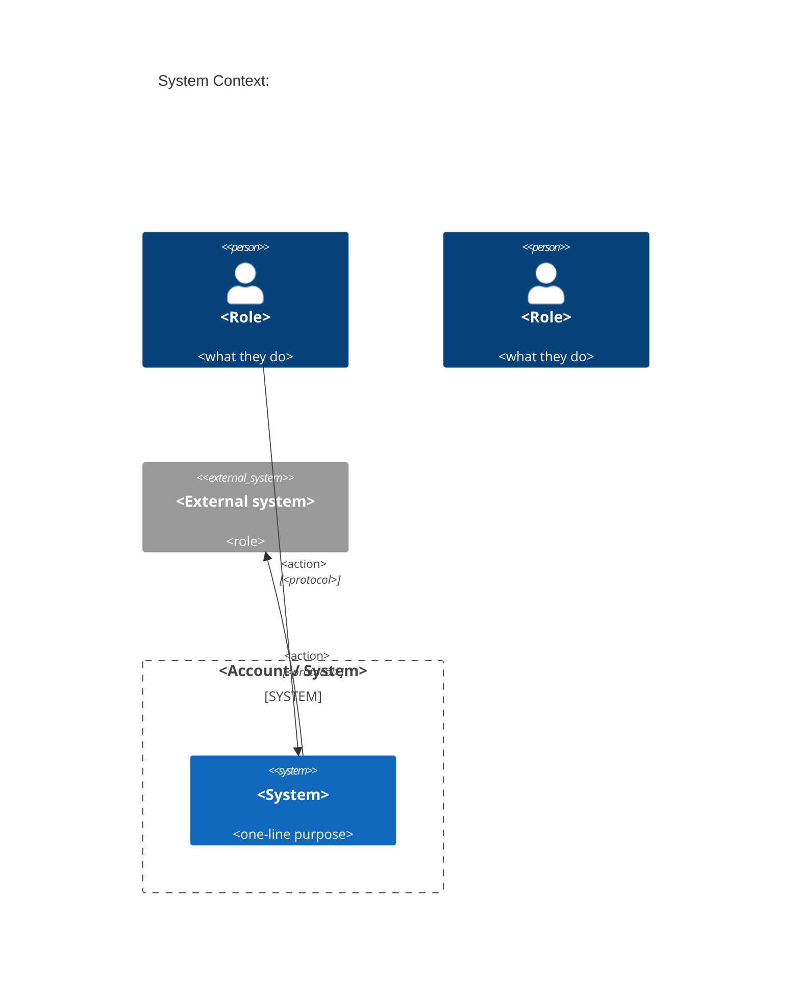

## L200: C4Container

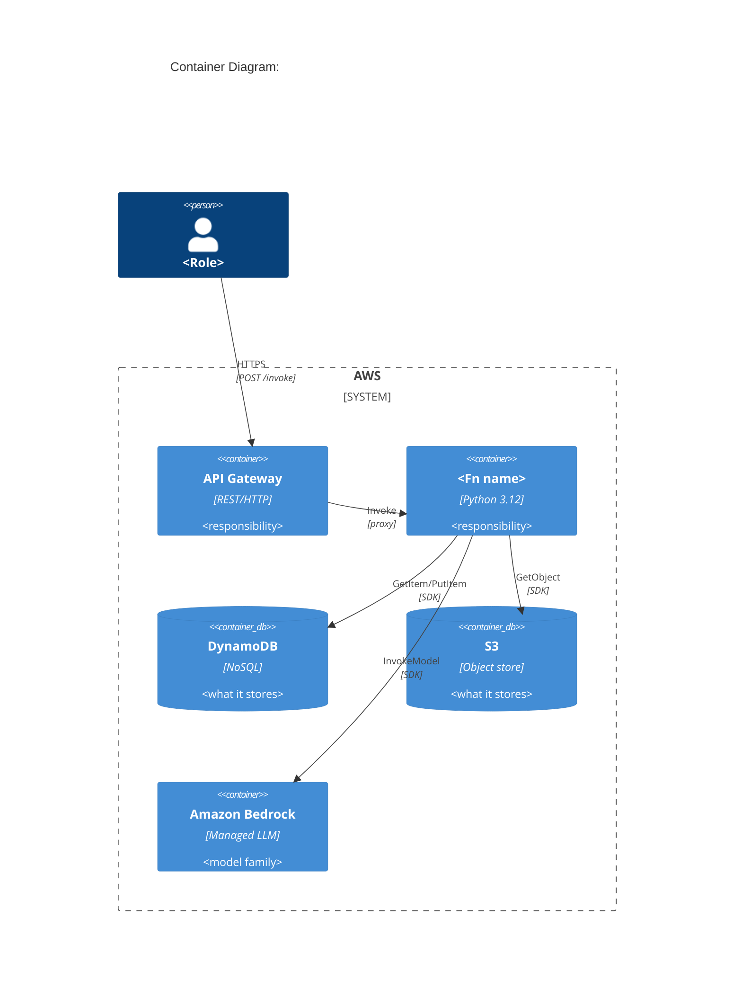

## L200: mindmap (IaC stack/module map)

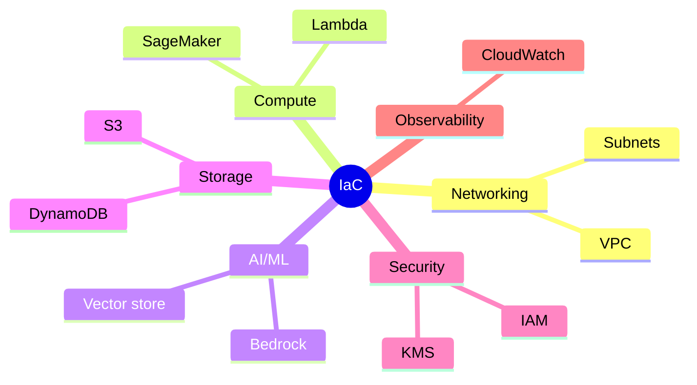

## L300: C4Component (inside one container)

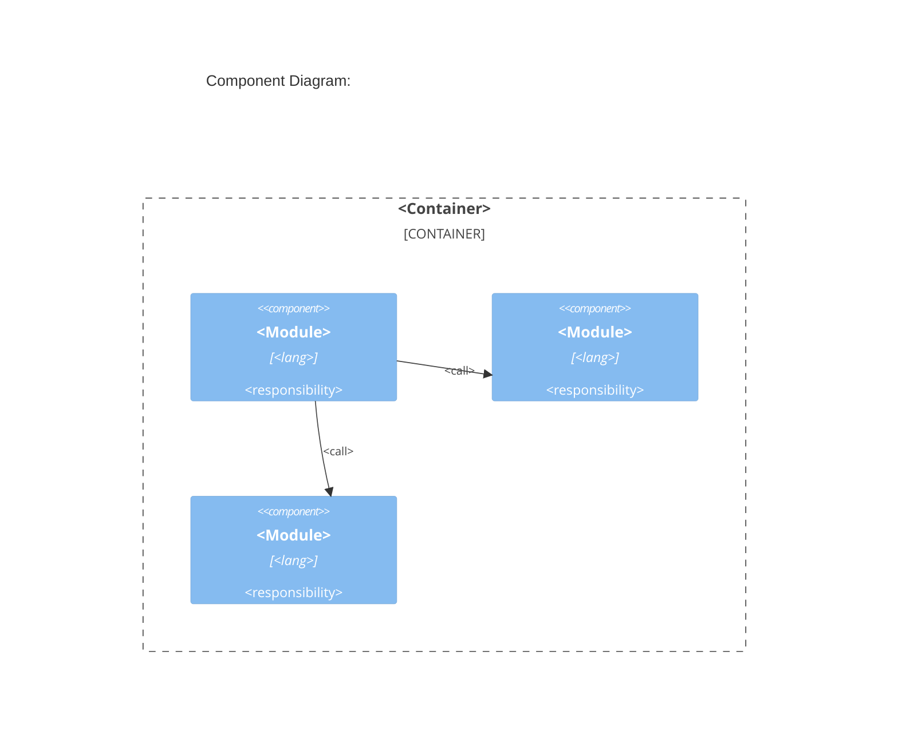

## L300: sequenceDiagram (inference / request flow)

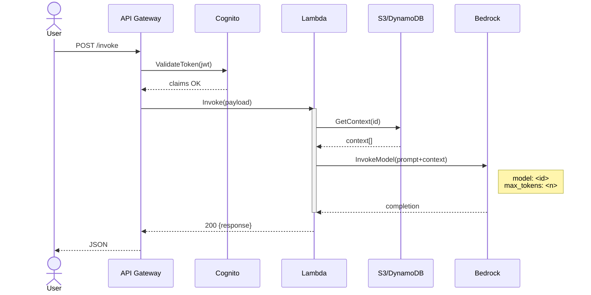

## L300: flowchart LR (ML training pipeline)

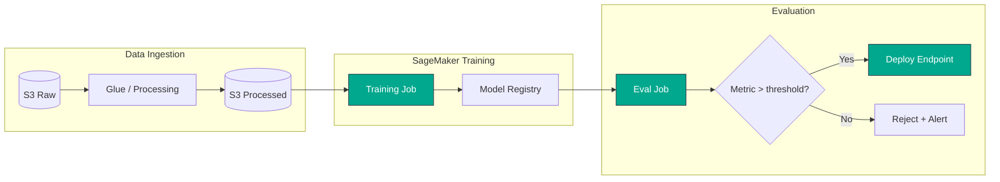

## L300: stateDiagram-v2 (job/model lifecycle)

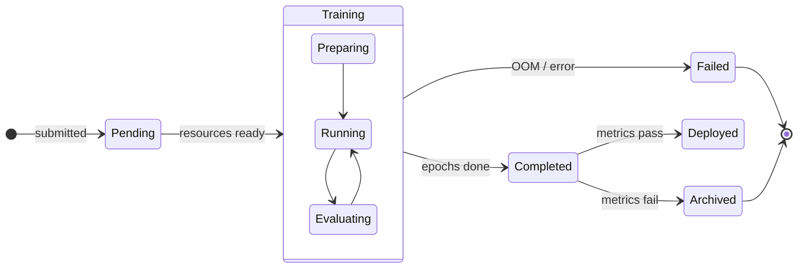

## L400: C4Deployment (per environment)

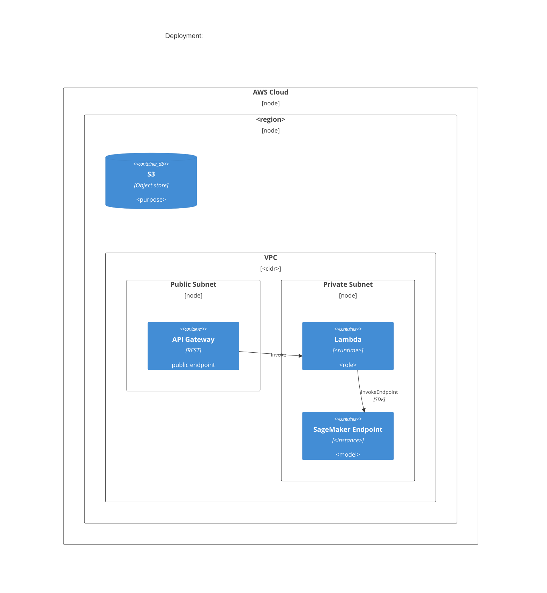

## L400: flowchart TB (account/region/VPC/subnet nesting)

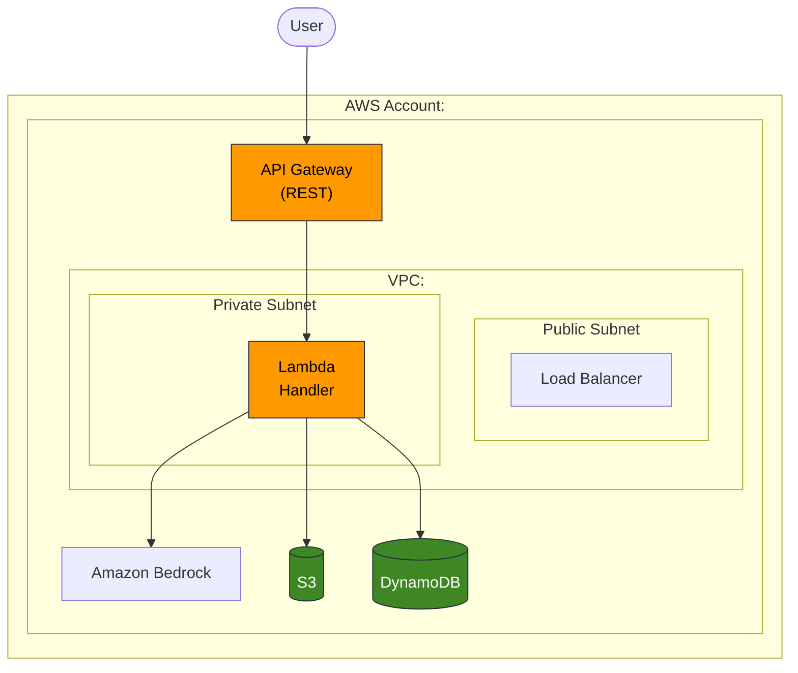

## L400: erDiagram (data model)

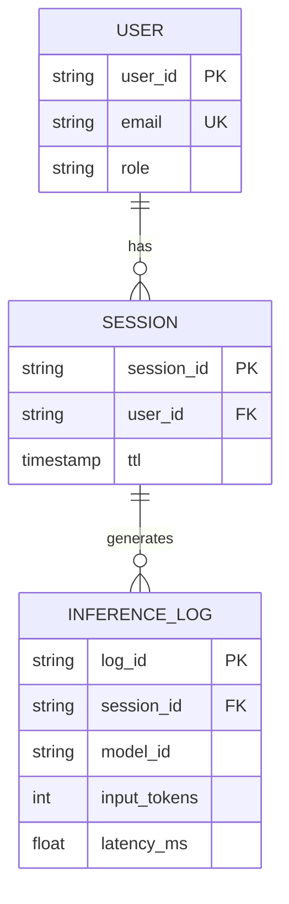

## L400: classDiagram (Pulumi component / CDK construct hierarchy, optional)

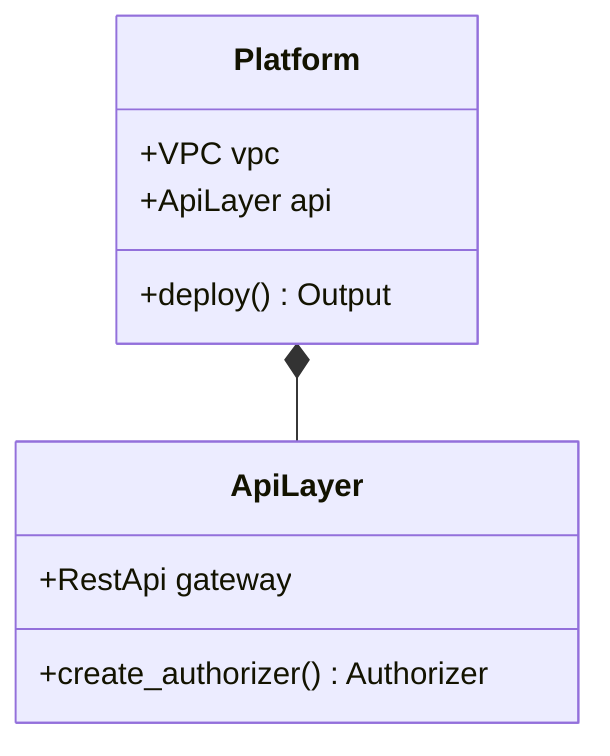

## Pre-commit diagram checklist

- [ ] Every node id maps to a `model.json` element id
- [ ] Every edge maps to a `model.json` edge (or labeled flow step)
- [ ] Labels with special chars are double-quoted
- [ ] `classDef` uses hex colors only
- [ ] Direction declared; subgraph ids unique vs node ids
- [ ] Within node/participant/element limits, else split
- [ ] C4 diagrams set `UpdateLayoutConfig`
- [ ] `stateDiagram-v2` (not `stateDiagram`); ER uses PK/FK
- [ ] No invented services/edges (verification pass)
- [ ] Checked against this list (a person may also validate in mermaid.live or with `mmdc`; the sandbox has neither)

## When Mermaid is not enough (document the limit, do not switch silently)

No official AWS icons, no cross-diagram links, no multi-view from one source, C4 breaks past ~10 elements. If a diagram needs more, split it or note the limit in prose. Alternatives (Structurizr DSL, D2, diagrams.py) are out of scope for docs-only Mermaid output; mention them in `07-risks.md` only if a real limit was hit.
